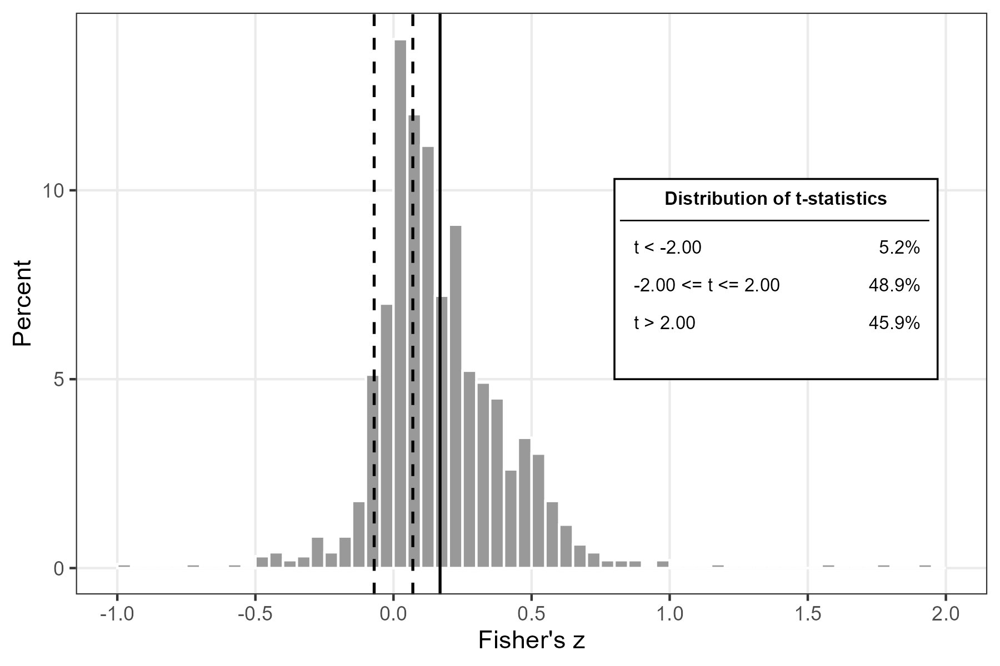
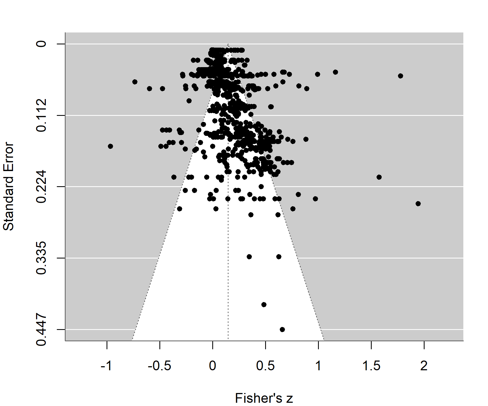
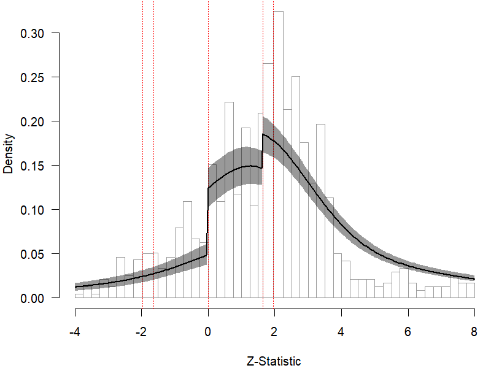
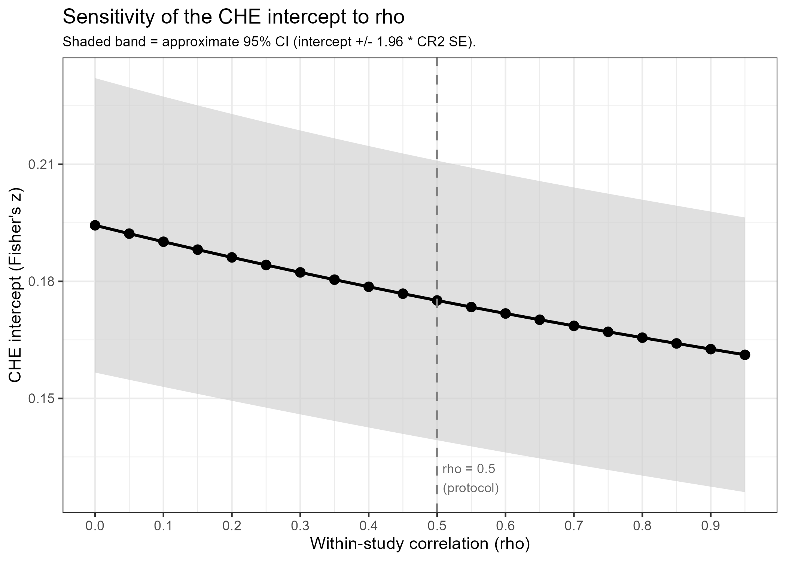
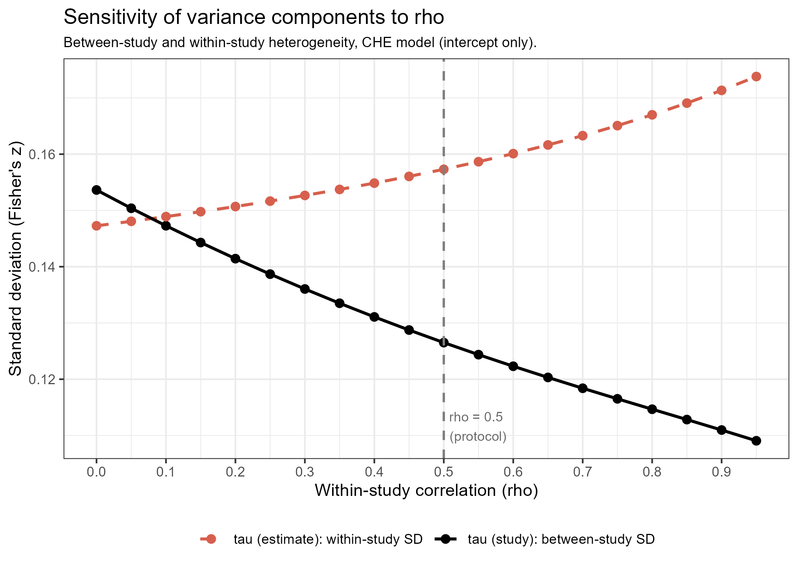
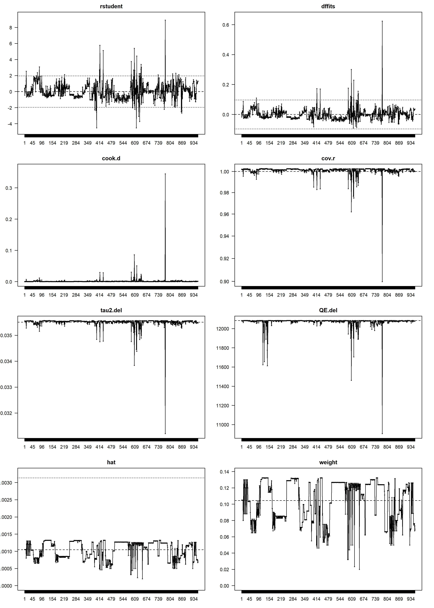
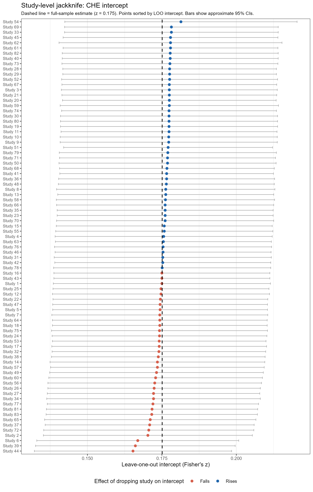

# Introduction {#sec-intro}

Meta-analysts increasingly work with databases in which individual studies contribute more than one effect size. Estimates from the same study share samples, data, and researchers, so they are not independent. This is the norm rather than the exception. Reviewing 1,000 meta-analyses across ten disciplines, Wu, Duan, Reed, and Tipton (2026) find that 57 percent contained dependent effect sizes, yet fewer than half of these (47 percent) made any statistical adjustment for the dependence. Wu and Reed (2026) find the same pattern in 100 meta-analyses published in leading management and marketing journals: 78 percent acknowledge that their effect sizes are dependent, but only 37 percent of those use a multilevel or multivariate model capable of addressing it. Current practice has not caught up with the data.

Dependence arises in several ways. A study may report effects for several outcome measures, for several follow-up periods on the same sample, or for several treatment groups compared with a common control group. Studies by the same research team, or studies that use overlapping samples, can also be related. Ignoring this dependence has two costs. First, treating the estimates as independent overstates the amount of information in the database. Standard errors are then too small, and hypothesis tests and confidence intervals do not have their nominal properties. Second, an analysis that assumes independence discards information about how the estimates covary, so its estimates of moderator effects are less efficient than they could be.

Dependence is not the only problem. Most meta-analytic databases are also affected by publication bias: estimates that are statistically significant, or that have the expected sign, are more likely to be reported than others. Here too, practice lags behind recommendations. Wu and Reed (2026) find that, among meta-analyses that test for publication bias, fewer than half go on to report a bias-corrected estimate. Most rely instead on the funnel plot and Fail-safe N, which have limited power to detect bias and offer no way to correct for it. The two problems are linked. A correction for publication bias must allow for the dependence among estimates, and recent work has developed corrections that do so (Rodgers and Pustejovsky, 2021; Chen and Pustejovsky, 2026; Pustejovsky, Citkowicz, and Joshi, 2026; van Aert, Riley, and Jackson, 2026; Bartoš, Maier, and Wagenmakers, 2026). These corrections differ in what they assume about how selection operates. Some treat each estimate as selected on its own statistical significance; others treat the study as the unit of selection, so that whether a study is published depends on how many of its estimates are significant. They need not give the same answer.

This creates a practical problem for applied researchers. The methods are scattered across a methodological literature, several are computationally demanding, and it is not obvious how they fit together: which dependence model to use, which correction for publication bias, and in what order the analyses should be done. A protocol addresses this problem in two ways. First, it sets out a single sequence of decisions and supplies ready-to-run R code for each step, which lowers the cost of applying recommended methods. Second, it limits what Simmons, Nelson, and Simonsohn (2011) call researcher degrees of freedom. Data cleaning, model specification, and bias correction each involve many defensible choices. Taken together, these choices give the analyst considerable latitude over the final estimate, a hazard that Gelman and Loken (2014) describe as a "garden of forking paths." Committing in advance to a documented sequence of estimators, corrections, and decision rules makes it less likely that the results guide the choice of method. It also lets the reader check what was done.

This protocol combines two lines of methodological work. The first is robust variance estimation. Pustejovsky and Tipton (2022) show that the correlated and hierarchical effects (CHE) working model, which allows for between-study heterogeneity, within-study heterogeneity, and correlated sampling errors, is a realistic description of the dependence found in social science meta-analyses. Combined with small-sample cluster-robust standard errors (Tipton, 2015; Tipton and Pustejovsky, 2015), it supports valid inference even when the working model is only approximately correct. The second is Robust Bayesian Meta-Analysis (RoBMA; Maier, Bartoš, and Wagenmakers, 2023), which averages over competing models of the selection process rather than committing to one. Its multilevel and meta-regression extensions (Bartoš, Maier, and Wagenmakers, 2026; Bartoš, Maier, Stanley, and Wagenmakers, 2025) handle dependent effect sizes and moderators, and version 4.1 of the RoBMA package estimates it with the CHE working model.

After data cleaning (@sec-cleaning) and a preliminary analysis (@sec-prelim), the protocol proceeds in five steps. First, @sec-estimators presents five estimators of the mean effect, leading up to CHE as the preferred dependence model. Second, @sec-pubbias compares three corrections for publication bias, all embedded within a dependence context. PET-PEESE (Stanley and Doucouliagos, 2014) treats selection as a smooth relationship between effect size and its standard error. Step-function selection models (Pustejovsky, Citkowicz, and Joshi, 2026) model the selection process directly. RoBMA is a Bayesian method that averages over both kinds of model. Third, @sec-diagnosis uses diagnostics of how selection operates in the data to choose one correction as the primary approach. Fourth, @sec-metareg estimates meta-regressions for all three corrections and uses them to predict the effect for a study that follows best research practice. Finally, @sec-sensitivity reports the final estimates from the primary approach and checks whether the conclusions depend on that choice. @sec-conclusion concludes. [Appendix A](#sec-app-rho) reports how sensitive the results are to the assumed correlation between the sampling errors of estimates from the same study, and [Appendix B](#sec-app-outliers) examines outliers and influential studies.

## How to Use This Protocol {#sec-intro-use}

**A quick start.** You do not need to read the whole protocol before running it. Download the project folder from GitHub, install JAGS (see @sec-software), open `MA_Protocol.Rproj`, then open `Protocol_Combined.qmd` and choose Run > Run All (Ctrl+Alt+R). The example data and saved results for the slowest models are included, so a complete pass takes about 45 minutes and confirms that every step runs on your computer. The explanations can then be read section by section, as they become relevant to your own analysis.

The protocol comes in two forms. The source is a Quarto document, `Protocol_Combined.qmd`, which combines the explanation with the R code that produces each table and figure. Opened in RStudio, it lets a researcher run the analysis by clicking through the code chunks in order, using the "Run" arrow on each chunk. Rendering the .qmd produces `Protocol_Combined.html`, the self-contained document most readers will read. The HTML version cannot run the code, but it shows it. The code for each step is folded under a "Code" button, and the "Code" menu at the top of the page shows the full .qmd source. The .qmd file, the rendered HTML, the R scripts, and the data are available at [github.com/bobreednz/ma-protocol-dependent-effects](https://github.com/bobreednz/ma-protocol-dependent-effects). To apply the protocol to a new meta-analysis, a researcher substitutes their own dataset and adjusts the variable names in the scripts, rather than writing new code for each method.

The protocol is illustrated throughout with data from Xue, Reed, and van Aert (2025), a meta-analysis of the association between social capital and economic growth published in the *Journal of Economic Surveys*. The dataset contains 957 effect size estimates from 83 studies, expressed as Fisher's z-transformed partial correlation coefficients (PCCs). It serves only as a running example. Because the example comes from economics, so do its moderators, its best-practice choices, and benchmarks such as the Doucouliagos (2011) guidelines for interpreting partial correlations. The same steps apply to any database of dependent effect sizes, although some details depend on the effect size; @sec-robma, for example, explains how RoBMA handles effect sizes other than Fisher's z.

Each analytical section has the same structure. A short explanation says what is being estimated and why. A "Run the script" chunk sources the R script that does the work, and a "Display the output" chunk reads the script's saved output into the document. Two kinds of commentary follow the output. "What to look for" explains how to read the output, in terms that apply to any dataset. "In this example" reports what the output shows for the social capital data. Where the researcher must make a choice before going on, a "Decision point" sets out the options and how to choose among them.

## Software Setup {#sec-software}

All analyses are conducted in R. Rendering the protocol also requires Quarto, which is included with recent versions of RStudio. Before running any script, run `Protocol_Install.R`, shown below. It installs every R package the protocol needs and prints the versions installed. The RoBMA results reported in this protocol were produced with RoBMA 4.1.1 and BayesTools 0.4.0.

The `metaselection` package, used for the step-function selection models in Sections [-@sec-pubbias] and [-@sec-metareg], is now available from CRAN. The results reported in this protocol were produced with version 0.1.5, a development build installed from GitHub.

RoBMA also requires JAGS (Just Another Gibbs Sampler), a standalone program that performs the underlying MCMC sampling. JAGS is not an R package and cannot be installed with `install.packages()`. Download and install JAGS (version 4.3.1 or newer) from <https://mcmc-jags.sourceforge.io/> before running `Protocol_Install.R`.

```{r}
#| label: install-packages
#| file: Protocol_Install.R
```

### Reproducibility: project setup instead of `setwd()`

This protocol uses the `here` package (installed by `Protocol_Install.R`) together with an RStudio Project file, `MA_Protocol.Rproj`, which is included in the project folder alongside the scripts and data, so that no script or the protocol document itself needs a hardcoded path.

To work with this protocol on your own machine: (1) download or clone the entire project folder, keeping all scripts, data files, and `MA_Protocol.Rproj` together in one folder; (2) open the project by double-clicking `MA_Protocol.Rproj` (or, in RStudio, File > Open Project); this sets your working directory to the project root automatically, with no path to edit. Every script then locates its files with `here("filename")` rather than a bare `"filename"`, which resolves relative to the project root regardless of your operating system or username.

```{r}
#| label: setup

library(here)        # resolves file paths relative to the project root (.Rproj)
library(readxl)     # read_excel() used in all display chunks
```

### Running the scripts

Each section's analysis is done by an R script, run separately from this document; rendering the protocol only reads the saved output files. The table lists the scripts in the order in which they should be run. Its run times are for a full run on the example data; with your own data they will vary with the numbers of estimates, studies, and moderators.

The five slowest scripts (9, 10, 15, 16, and 19) load saved results for the example data by default. A reader who wants to check that everything runs on their own computer can therefore step through all the scripts in under an hour. On the example data, most of that time goes to the PET-PEESE regressions (script 7) and the rho sensitivity analysis (script 18). When you apply the protocol to your own data, set `refit <- TRUE` at the top of each of these five scripts; otherwise they will report the saved results for the example data.

| # | Script | Section | Main output | Full run time |
|:--|:--|:--|:--|:--|
| 1 | `Protocol_DataCleaning.R` | [-@sec-cleaning] | `SCData_processed.rds`, `DataCleaning_Report.xlsx` | seconds |
| 2 | `Protocol_Variables.R` | [-@sec-prelim-vars] | `Table_Variables.xlsx` | seconds |
| 3 | `Protocol_EffectSizes.R` | [-@sec-prelim-dist] | `Table_EffectSizes.xlsx`, `Figure_EffectSizes.png` | seconds |
| 4 | `Protocol_StudyWeights.R` | [-@sec-prelim-weights] | `Table_StudyWeights.xlsx` | seconds |
| 5 | `Protocol_FiveEstimators.R` | [-@sec-estimators] | `Table_FiveEstimators.xlsx` | about 2 minutes |
| 6 | `Protocol_FunnelPlot.R` | [-@sec-funnel] | `Figure_FunnelPlot.png` | seconds |
| 7 | `Protocol_CHE_PET.R`, `Protocol_CHE_PEESE.R` | [-@sec-petpeese] | `Table_CHE_PET.xlsx`, `Table_CHE_PEESE.xlsx` | 5 to 7 minutes each |
| 8 | `Protocol_CHE_ISCW.R` | [-@sec-petpeese] | `Table_CHE_ISCW.xlsx` | 1 to 3 minutes |
| 9 | `Protocol_SelectionModels.R` | [-@sec-selection] | `Table_SelectionModels.xlsx` | about 3 minutes |
| 10 | `Protocol_RoBMA_CHE_Intercept.R` | [-@sec-robma] | `Table_RoBMA_CHE_Intercept.xlsx` | about 3.5 hours |
| 11 | `Protocol_Zplot_CHE.R` | [-@sec-zplot] | `Figure_Zplot_CHE.png` | about 5 minutes |
| 12 | `Protocol_Diagnostics.R` | [-@sec-weights] | `Table_Diagnostics.xlsx` | seconds |
| 13 | `Protocol_CHE_PETPEESE_MetaReg.R` | [-@sec-mr-petpeese] | `Table_CHE_PETPEESE_MetaReg.xlsx` | 1 to 2 minutes |
| 14 | `Protocol_CHE_PETPEESE_BestPractice.R` | [-@sec-mr-petpeese] | `Table_CHE_PETPEESE_BestPractice.xlsx` | under a minute |
| 15 | `Protocol_Selection_MetaReg.R` | [-@sec-mr-selection] | `Table_Selection_MetaReg.xlsx` | 15 to 20 minutes |
| 16 | `Protocol_RoBMA_CHE_MetaReg.R` | [-@sec-mr-robma] | `Table_RoBMA_CHE_MetaReg.xlsx` | about 4 hours |
| 17 | `Protocol_Sensitivity.R` | [-@sec-sensitivity] | `Table_Sensitivity.xlsx` | seconds |
| 18 | `Protocol_RhoSensitivity.R` | [App. A](#sec-app-rho) | `Table_RhoSensitivity.xlsx`, two figures | 10 to 15 minutes |
| 19 | `Protocol_Outliers.R` | [App. B](#sec-app-outliers) | `Table_Jackknife_CHE.xlsx`, two figures | about 1.5 hours |

---

# Data Cleaning and Quality Checks {#sec-cleaning}

Before any analysis can proceed, the raw dataset must be inspected and cleaned. This step is essential for any meta-analysis, but it requires particular care when effect sizes are dependent, because errors in coding, such as duplicated observations or inconsistent standard errors, can be difficult to detect when multiple estimates come from the same source.

## What the cleaning script does {#sec-cleaning-script}

The script `Protocol_DataCleaning.R` runs eight sequential quality checks on the raw dataset (`SCData (20240508).dta`). These checks address the most common data problems in meta-analytic databases:

1. **Missing values.** Identifies observations with missing values in any variable.
2. **Duplicates and coding conflicts.** Detects rows that are exact copies of one another (true duplicates) and rows from the same study that share the same effect size, standard error, and t-statistic but differ in their coding of other variables (coding conflicts).
3. **Valid ranges.** Verifies that binary variables contain only 0/1 values and that key continuous variables (standard errors, degrees of freedom, publication year) fall within plausible bounds.
4. **Mutual exclusivity.** Verifies that each set of mutually exclusive dummy variables (social capital type, outcome type, geographic level, region, endogeneity treatment) sums to exactly one for every observation.
5. **Internal consistency of derived variables.** Verifies that the Fisher's z, partial correlation, and t-statistic variables satisfy their defining relationships (z = atanh(pcc); t = pcc/se).
6. **Standard error consistency.** Flags observations whose reported standard error is smaller than the value implied by the reported degrees of freedom, distinguishing minor discrepancies (likely rounding artifacts) from major ones (possible coding errors).
7. **Outlier effect sizes.** Flags observations with exceptionally large effect sizes, using both an absolute threshold and a distance-from-the-mean criterion.
8. **Small degrees of freedom.** Flags observations from regressions with very few degrees of freedom, which may yield unreliable standard errors.

**A note on traceability to source studies.** None of the eight checks above can substitute for being able to trace a specific effect size back to its exact location in the original publication. The dataset used in this protocol (`SCData (20240508).dta`) does not include variables recording the table, page, and regression (or column) number in the source paper from which each estimate was extracted. This is a limitation of the illustrative dataset, not a feature of good practice: whenever a flagged or otherwise suspect observation needs to be checked, the researcher must be able to open the original paper and locate the exact estimate in question, which is only possible if this information was recorded at the time of data extraction. We recommend that any meta-analytic dataset include these identifiers as standard practice, alongside the study identifier (`newid`) already present here.

No observations are dropped during this step. Instead, the observation-level checks add binary flag variables to the dataset, and an omnibus flag (`flag_any`) marks any observation that triggers at least one of them. It is up to the researcher to inspect these flags and decide which, if any, to act upon before proceeding.

The script exports a five-sheet Excel report (`DataCleaning_Report.xlsx`) summarizing each check, a flagged dataset (`SCData_flagged.dta`) containing the original data plus the flag columns, and a processed dataset (`SCData_processed.rds`) that all subsequent analysis scripts load. For this protocol, the processed dataset is identical to the raw data. No flagged observations are dropped, in order to maintain comparability with Xue, Reed, and van Aert (2025). For their own research, researchers should first inspect `DataCleaning_Report.xlsx` and decide which flagged observations should be dropped or revised. They should then apply those changes to the flagged dataset and save the resulting file as `SCData_processed.rds` before running any subsequent scripts. Researchers are also encouraged to maintain a log documenting each change and the reason for it.

**Note for readers using non-Stata data.** The cleaning script reads the raw dataset using `read_dta()` from the `haven` package, which is specific to Stata `.dta` files. If your data are stored in a different format, replace that line with the appropriate R function: `read.csv()` for CSV files, `read_excel()` from `readxl` for Excel files, or `load()` / `readRDS()` for R-native formats. All subsequent scripts load `SCData_processed.rds` using `readRDS()` and require no modification for non-Stata data.

## Run the cleaning script

```{r}
#| label: data-cleaning

source("Protocol_DataCleaning.R")
```

## Inspect the output

```{r}
#| label: data-cleaning-report
#| eval: true

library(readxl)

# View a summary of each quality check
read_excel("DataCleaning_Report.xlsx", sheet = 1)
```

**What to look for.** The researcher should examine whether any observations are flagged by the major standard error check or the coding conflict check, as these are the most likely to reflect genuine errors. Minor standard error discrepancies and small degrees of freedom flags are often a normal feature of the literature and may not require action. True duplicates, if present, should always be investigated. The outlier flags identify extreme effect sizes that may warrant examination in the outlier analysis ([Appendix B](#sec-app-outliers)), but they do not automatically indicate erroneous data.

**Decision point.** For each flagged observation, decide whether to correct it, drop it, or keep it as it is, and record the decision and the reason in the log.

**In this example.** No observations are excluded following this review. The processed dataset is identical to the raw data, and all 957 effect sizes proceed to analysis.

---

# Preliminary Analysis {#sec-prelim}

Before estimating any formal meta-analytic model, it is useful to characterize the dataset: what variables are available and how the effect sizes are distributed. These two steps correspond to @tbl-table1, @tbl-table2, and @fig-figure1 of the protocol.

## Variable Descriptions {#sec-prelim-vars}

@tbl-table1 provides a reference guide to all variables in the dataset. For continuous variables, it reports the mean, minimum, and maximum. For binary variables, it reports the mean (which equals the proportion of ones) and the number of studies contributing at least one observation with a value of one. The latter is reported to flag cases where a variable takes the value one for many observations but those observations come from only a small number of studies, which can make meta-regression estimates for that variable unreliable. Reference categories are marked with an asterisk.

This table serves two purposes. First, it allows the reader to verify that the dataset matches expectations and that no variables have unexpected ranges or implausible values. Second, it provides the descriptive information needed to interpret the meta-regression coefficients in @sec-metareg, where understanding what each variable represents and what value of one means is essential for forming best-practice predictions.

### Run the script

```{r}
#| label: table1-run

source("Protocol_Variables.R")
```

### Display the output

```{r}
#| label: tbl-table1
#| eval: true
#| tbl-cap: "Variable descriptions."

library(readxl)
library(knitr)

tbl1 <- read_excel("Table_Variables.xlsx")

# The footnote is stored as its own row in the sheet (in the Group column),
# with a blank spacer row above it. Extract the note text, then drop both
# non-data rows, matching the convention used for the other table notes in
# this document.
note_text1 <- tbl1$Group[grepl("^Note:", tbl1$Group)]
tbl1 <- tbl1[!is.na(tbl1$Group) & !grepl("^Note:", tbl1$Group), ]

tbl1 |> knitr::kable()

knitr::asis_output(paste0(
  '<div style="margin-top: 0.25em; text-align: left;"><p><em>', note_text1, '</em></p></div>\n\n'
))
```

**What to look for.** Verify that the effect size variable (`z`) and its standard error (`sez`) have plausible ranges: Fisher's z values for partial correlations are typically bounded between roughly -1 and 1, and standard errors should be positive. For the binary control variables, note which categories are underrepresented, as variables with very few observations coded as one may be collinear with others or may be unreliable in the meta-regression. Pay particular attention to the Studies column: if every observation coded as one comes from a single study or a small number of studies, the variable is effectively a dummy for those studies, and its meta-regression coefficient cannot be cleanly separated from other idiosyncratic features of their design or sample.

**In this example.** `CityLevel` takes the value one for 35 observations, all from a single study, so its coefficient in @tbl-pet-mods should be read with that in mind. The same moderator causes most of the failed bootstrap replications in @sec-mr-selection.

---

## Effect Size Descriptives and Distribution {#sec-prelim-dist}

@tbl-table2 reports descriptive statistics for the effect size distribution: the mean, median, standard deviation, minimum, and maximum of the effect size estimates and their t-statistics, along with the distribution of degrees of freedom. @fig-figure1 displays a histogram of the Fisher's z values, annotated with the mean and with vertical reference lines at the Doucouliagos (2011) threshold of $|z| = 0.07$, the boundary between negligible and small effects in the partial correlation literature.

Doucouliagos (2011) proposed benchmarks of 0.07, 0.17, and 0.33 for small, medium, and large partial correlations in economics, derived from the observed distribution of over 22,000 partial correlations. These are different from Cohen's (1988) thresholds of 0.10, 0.30, and 0.50 because the latter were developed for zero-order (simple) correlations. Applying Cohen's thresholds to partial correlations would systematically understate practical significance, since partial correlations are mechanically smaller once other variables have been partialled out. 

Doucouliagos (2011) was never formally published and is not readily available online, but it remains the standard benchmark for partial correlations in the applied economics meta-analysis literature, with over 150 citing papers recorded on RePEc/IDEAS. Only the small-effect threshold (0.07) is drawn on @fig-figure1. Researchers working with other effect size metrics should replace the Doucouliagos (2011) benchmarks with thresholds appropriate to their context. These values can be substituted directly into the figure script.

An inset table in the figure shows the breakdown of observations by the statistical significance of the associated t-statistic.

These two outputs together give an initial picture of where the evidence is concentrated in the effect size distribution and how much of the literature reports statistically significant results. Both are directly relevant to the publication bias analysis in @sec-pubbias.

### Run the script

```{r}
#| label: table2-figure1-run

source("Protocol_EffectSizes.R")
```

### Display the output

```{r}
#| label: tbl-table2
#| eval: true
#| tbl-cap: "Descriptive statistics for the effect size distribution."

read_excel("Table_EffectSizes.xlsx") |> knitr::kable()
```

```{r}
#| label: fig-figure1
#| eval: true
#| fig-cap: "Distribution of Fisher's z-transformed effect sizes."

library(knitr)


```

**What to look for.** The mean and median effect sizes provide an initial (unadjusted) sense of the central tendency of the literature. A large share of statistically significant results, visible in the inset table, raises the possibility of selective reporting and motivates the formal tests in @sec-pubbias. A distribution that is noticeably skewed or multimodal may suggest that the literature is not homogeneous and that moderator analysis is warranted. The converse does not hold, however: a unimodal, symmetric distribution does not rule out moderator effects, which may be present even when the marginal distribution of effect sizes appears well behaved.

**In this example.** The mean Fisher's z is 0.169 and the median 0.133, which correspond to partial correlations of 0.157 and 0.133. By the Doucouliagos (2011) benchmarks, both lie between a small (0.07) and a medium (0.17) effect. The inset shows that 45.9 percent of the estimates have t-statistics above 2, against only 5.2 percent below -2. That asymmetry is consistent with selective reporting, but not proof of it, since a positive true effect would also produce more significant positive estimates than negative ones. @sec-pubbias examines it formally.

---

# The Starting Point: Five Models {#sec-estimators}

Before correcting for publication bias, the researcher needs an estimate of the mean effect that allows for the dependence among estimates from the same study. This section builds that estimate in steps. It starts with the two models most often used in practice, fixed effects (FE) and random effects (RE), which treat every estimate as independent. It then adds the two sources of dependence one at a time. The hierarchical effects (HE) model allows estimates from the same study to share part of their true effect. The correlated effects (CE) model allows their sampling errors to be correlated. The correlated and hierarchical effects (CHE) model allows for both. Seeing the five models side by side shows how each source of dependence changes the estimate and its standard error. The CHE estimate is the uncorrected mean effect from which the corrections in @sec-pubbias start.

## The Five Models {#sec-estimators-models}

The five models build on one another. FE and RE ignore the dependence among estimates from the same study. HE and CE each add one source of dependence, and CHE combines both. All are estimated using the `rma.mv()` function from the `metafor` package (Viechtbauer, 2010), with cluster-robust (CR2) standard errors from `clubSandwich` (Pustejovsky, 2026). The five models differ in how they specify the random-effects structure and the variance-covariance matrix of the effect sizes.

**Fixed effects (FE).** No random effects. Each effect size is weighted by the inverse of its known sampling variance. This estimator assumes that the true effect is identical across all studies and all effect sizes, and is included primarily as a baseline for likelihood ratio testing.

**Random effects (RE).** A single observation-level random effect, implemented as `~ 1 | obs` on the individual effect size identifier, so that each effect size estimate receives its own random effect. This is the conventional meta-analytic model and assumes that within-study estimates are conditionally independent.

**Hierarchical effects (HE).** Two random effects, `~ 1 | newid/obs`, with a diagonal variance matrix. This model allows for both between-study and within-study heterogeneity in the true effect, but does not model correlated sampling errors.

**Correlated effects (CE).** A single study-level random effect, implemented as `~ 1 | newid`, combined with an imputed block-diagonal covariance matrix that allows for a constant within-study sampling correlation (denoted $\rho$). This model captures correlated sampling errors but does not allow for within-study heterogeneity in the true effect. In other words, it assumes a common true effect across all estimates within a study, with deviations attributable solely to correlated sampling errors arising from shared samples, correlated outcome measures, and similar sources.

**Correlated and hierarchical effects (CHE).** Two random effects, `~ 1 | newid/obs`, combined with an imputed block-diagonal covariance matrix. This model accommodates between-study heterogeneity, within-study heterogeneity, and correlated sampling errors simultaneously, and is the preferred default model following Pustejovsky and Tipton (2022).

For the CE and CHE models, the imputed block-diagonal covariance matrix is constructed using `vcalc()` from `metafor`, under the assumption of a constant within-study sampling correlation $\rho$. @sec-rho explains how to choose its value.

All five models estimate the mean effect as a weighted average of the individual estimates, but they differ in how they interpret the information from additional estimates. FE and RE treat every estimate as an independent piece of information. Other things equal, a study with 20 estimates therefore counts about 20 times as much as a study with one. In contrast, HE, CE, and CHE recognize that estimates from the same study share that study's true effect, and often its data, so additional estimates tell us more about that one study, but little more about the average across studies. Each additional estimate therefore adds less weight than the one before, and beyond some point a study gains almost nothing by reporting more.

This matters because there are two averages a researcher might want to estimate: the average effect across individual estimates, and the average effect across studies. When effect sizes are unrelated to the number of estimates a study reports, the two averages take the same value, and all five models estimate the same mean. However, when the size of the effect is related to the number of estimates a study reports, the two averages differ. FE and RE give more weight to studies that report many estimates, which pulls their means toward the average across estimates, while HE, CE, and CHE give means closer to the average across studies than FE and RE do. Because the weights also depend on the precision of the estimates, the estimated means need not equal either simple average.

The choice of model therefore also reflects the mean the researcher wants to estimate. In FE and RE, the mean is the average across estimates. In HE, CE, and CHE, it is the average across studies. When the estimates from a study are mostly alternative specifications of the same analysis, as in this example, the average across studies is usually the more natural target.

**More than one level of nesting.** The five models assume a single level of nesting: estimates within studies. Some meta-analyses have a further level, such as several experiments or samples within a paper, each contributing several estimates. CHE extends to this case by adding a random effect for the intermediate level (in `metafor`, `random = ~ 1 | study/sample/estimate`) and by building the sampling covariance matrix within samples rather than within studies (`cluster = sample` in `vcalc()`), since estimates from different samples share no data. Cluster-robust inference is still clustered at the highest level, the study.

## Study Weights and Heterogeneity {#sec-prelim-weights}

@tbl-table3 examines how study weights are distributed across the literature under fixed-effects (FE), random-effects (RE), and hierarchical effects (HE) estimation. Because the dataset contains multiple effect sizes per study, the script first aggregates to the study level by computing a precision-weighted mean effect size for each of the 83 studies, and then fits FE and RE models to the 83 study-level values. Because they are fitted to study-level means, these FE and RE results differ slightly from those in @tbl-table4, which fits the models to all 957 estimates. The HE weights are computed differently: they come from the full observation-level multilevel model, using the row sums of its GLS weight matrix summed to the study level. Under FE, a study's weight is the sum of the precisions of its estimates, so it rises in proportion to the number of estimates the study reports. Under RE fitted to the study means, and under HE, a study gains less weight from each additional estimate, for the reason given in @sec-estimators-models.

The table reports summary statistics of the weight distribution (mean, median, selected percentiles) and the shares of total weight captured by the three and ten largest contributors. It also reports the standard deviation of the true effects between studies, $\hat{\tau}_{\text{study}}$ (RE and HE), and within studies, $\hat{\tau}_{\text{estimate}}$ (HE only), together with $I^2$. Because the RE model here is fitted to the study means, its heterogeneity is between studies. The RE model in @tbl-table4, fitted to all 957 estimates, instead reports the total heterogeneity across estimates.

### Run the script

```{r}
#| label: table3-run

source("Protocol_StudyWeights.R")
```

### Display the output

```{r}
#| label: tbl-table3
#| eval: true
#| tbl-cap: "Study weights and heterogeneity."

readxl::read_excel("Table_StudyWeights.xlsx") |> knitr::kable()
```

**What to look for.** Under FE weighting, weight is concentrated in the most precise (typically largest) studies; under RE weighting, weights are more equalized because the between-study variance places a ceiling on how much any single study can contribute. HE weighting behaves like RE in this respect, since its variance components likewise cap the contribution of any single study. If the weight distribution is highly unequal, for example if the three largest studies account for most of the total FE weight, the overall FE estimate is driven by a small number of studies. This is problematic if the true effects underlying those studies are not representative of the literature as a whole. Judge heterogeneity by $\hat{\tau}_{\text{study}}$ and $\hat{\tau}_{\text{estimate}}$. They are on the same scale as the effect sizes, so they can be compared with the mean effect or with a benchmark for a small effect. $I^2$ is reported because it is widely used, but it does not measure how much the true effects vary (Borenstein et al., 2017). It is the share of the observed variation that is not due to sampling error, so it depends on how precise the estimates are. When the estimates are very precise, $I^2$ is high even if the true effects vary little; when they are imprecise, $I^2$ can be low even if the true effects vary a great deal.

**In this example.** Under FE weighting, the weights are extremely concentrated: one study receives 36.4 percent of the total weight, the three largest 63.3 percent, and the ten largest 89.1 percent. Under RE and HE weighting, the three largest studies receive only 4.0 and 4.6 percent. Heterogeneity is large. Under HE, the standard deviation of the true effects is 0.154 between studies and 0.147 within studies, each comparable in size to the mean effects in @tbl-table4. The case for random effects is clear. $I^2$ is 99.7 percent under RE and 97.8 percent under HE, but these values partly reflect how precise many of the estimates are. The concentration of FE weight is also why @sec-petpeese carries forward CHE-PET-PEESE rather than the CHE-ISCW version, whose weights resemble FE weights.

@tbl-table3 does not report weights for CE and CHE. Both models require an assumed value for the correlation between the sampling errors of estimates from the same study, which the next subsection explains.

## The Choice of Rho {#sec-rho}

Before the five models can be estimated, the researcher must choose a value for $\rho$, the assumed within-study sampling correlation used to construct the imputed block-diagonal covariance matrix for the CE and CHE models. This value governs the degree to which effect size estimates from the same study are treated as correlated in their sampling errors.

This correlation has a true value. It can sometimes be computed from information in the original studies, for example from sample sizes and the degree of sample overlap among estimates (Bom and Rachinger, 2020). Otherwise, it cannot be identified from the effect sizes and standard errors alone, and it cannot be selected by the likelihood or by any other model-comparison criterion. $\rho$ enters the assumed sampling-covariance matrix rather than the random-effects model, so different values of $\rho$ correspond to different assumed data rather than to competing models fit to the same data.

In reality, each pair of estimates probably has its own true correlation, and primary studies rarely report them. The standard practice is therefore to assume a single value for all pairs, commonly $\rho = 0.5$, and to verify by sensitivity analysis that the substantive conclusions do not depend on the value chosen. The simplification matters less than it might appear, because the protocol uses cluster-robust standard errors. A wrong value of $\rho$ affects how efficiently the models use the data, but not the validity of the standard errors and tests, provided the number of studies is not too small (Pustejovsky and Tipton, 2022). When the estimates within a study are alternative specifications estimated on the same data, the true correlation may be well above 0.5, so the sensitivity analysis should extend to high values; the one in [Appendix A](#sec-app-rho) runs to 0.95.

**Decision point.** Adopt a plausible constant value for $\rho$ ($\rho = 0.5$ by default) and, before estimating the five models, run the sensitivity analysis in [Appendix A](#sec-app-rho) to confirm that the substantive conclusions do not depend on the value chosen. Report the value used together with the sensitivity analysis.

**In this example.** The protocol adopts $\rho = 0.5$ throughout. The sensitivity analysis in [Appendix A](#sec-app-rho) shows that the mean effect is stable across the full range of $\rho$.

## Estimation strategy {#sec-estimators-strategy}

All models are estimated using `rma.mv()` from `metafor`. REML is used for the main reported results (the intercept and variance components). ML estimation is used only for the purpose of computing likelihood ratio statistics, since likelihood ratio tests require that both nested models be estimated by the same method (ML rather than REML). Cluster-robust standard errors of the CR2 type (Tipton and Pustejovsky, 2015) are computed using `coef_test()` from `clubSandwich`, with clustering at the study level (`newid`).

The CR2 standard errors are used for all inference throughout this protocol. They are preferable to the model-based standard errors produced by `rma.mv()` because they remain valid even when the working model for the dependence structure is misspecified. Given the complexity of real meta-analytic data, misspecification should be considered the norm rather than the exception (Pustejovsky and Tipton, 2022).

## Choosing the Working Model {#sec-estimators-lr}

The working model should be the simplest one that matches how the data were generated. With cluster-robust standard errors, this choice affects the precision of the estimates, not the validity of the standard errors and tests, provided the number of studies is not too small (Pustejovsky and Tipton, 2022). CHE is the recommended default for most meta-analytic applications because, when studies report several estimates from the same or overlapping samples, it is the simplest of the five models that allows for both sources of dependence: similar true effects within a study, and correlated sampling errors among estimates computed from the same data (Pustejovsky and Tipton, 2022). A simpler model is enough when only one source is present. If the estimates within a study come from independent samples, their sampling errors are uncorrelated, and HE is sufficient. If they measure a single effect with little reason for their true effects to differ, CE is sufficient. When the estimates from a study are different specifications estimated on the same or overlapping samples, as is common in economics, both sources are present and CHE is the natural choice.

@tbl-table4 also reports three likelihood ratio tests (the note below the table gives the comparison each one makes). A significant result indicates that the added variance component is present in the data: between-study heterogeneity for RE against FE, within-study heterogeneity for HE against RE, and within-study heterogeneity in the presence of correlated sampling errors for CHE against CE. A direct test of CHE against HE is not available, because the two models use different sampling covariance matrices. The tests describe the data, but they should not be used to choose the model, for two reasons. First, like the older practice of using the Q-test to choose between fixed and random effects, they can show that a component is needed, but a non-significant result does not show that it can be dropped, because the tests may lack power. Second, the tests are valid only if the working model is correct, including the assumed value of $\rho$. The cluster-robust standard errors used for all other inference in this protocol remain valid even when the working model is wrong, and that is the reason for using them.

## Run the script

```{r}
#| label: table4-run

# Note: this script takes approximately 2 minutes to run.
source("Protocol_FiveEstimators.R")
```

## Display the output

@tbl-table4 presents the five models side by side in a single table, allowing direct comparison of the intercept (the overall mean effect), the standard error, the assumed within-study correlation ($\rho$), the prediction interval, the heterogeneity estimates, and likelihood ratio tests.

The "rho (assumed)" row is shown only for CE and CHE, since these are the two models that use the imputed covariance matrix built with $\rho = 0.5$ (@sec-rho). It is reported as a fixed, assumed value rather than as an estimate: unlike the three tau rows, which the model estimates from the data, $\rho$ is set by the researcher beforehand and used to construct the working covariance matrix. FE, RE, and HE do not use this covariance matrix, so $\rho$ does not apply to them.

The three tau rows report standard deviations of the true effects. The "tau (study)" row is the variation between studies, and the "tau (estimate)" row is the variation among estimates from the same study. The "tau (total)" row combines the two, $\hat{\tau}_{\text{total}}$ $= \sqrt{\hat{\tau}^2_{\text{study}} + \hat{\tau}^2_{\text{estimate}}}$. RE has one random effect for each estimate and ignores which study the estimate comes from, so its single variance component appears only in the \"tau (total)\" row. CE has one random effect for each study, so its \"tau (study)\" and \"tau (total)\" rows are the same. The \"tau (total)\" row is comparable with the total heterogeneity that RoBMA reports in @sec-robma.

The "95% PI" row is the 95% prediction interval. It adds the total heterogeneity to the uncertainty about the mean, so it describes the range within which the true effect underlying a new estimate is expected to fall. As in @sec-mr-petpeese, it does not include sampling error. FE assumes that all estimates share one true effect, so it has no prediction interval.

```{r}
#| label: tbl-table4
#| eval: true
#| tbl-cap: "The five models."

read_excel("Table_FiveEstimators.xlsx", col_types = "text") |> knitr::kable()

knitr::asis_output(paste0(
  '<div style="margin-top: 0.25em; text-align: left;"><p><em>Note: 95% PI = prediction interval for the true effect underlying a new estimate; it does not include sampling error. ',
  'tau (study), tau (estimate), and tau (total) are the standard deviations of the true effects between studies, within studies, and in total. ',
  'The LR test row reports ',
  'the p-value from a likelihood ratio test of that column\'s model against a simpler nested ',
  'alternative, with both models refit via ML for comparability: RE tests RE vs. FE (whether a ',
  'random effect improves fit over no random effects at all); HE tests HE vs. RE (whether a ',
  'second, within-study variance component improves fit); CHE tests CHE vs. CE (whether that ',
  'same within-study variance component improves fit once within-study correlation is already ',
  'modeled). A p-value below the conventional 0.05 threshold favors the more complex (column) ',
  'model over its simpler comparison. FE and CE show no entry because each serves as the ',
  'simpler baseline in one of these comparisons rather than the model being tested; see the ',
  'discussion above for why no direct test of CHE against HE is available.</em></p></div>\n\n'
))
```

**What to look for.** The primary quantity of interest is the CHE intercept, which gives the overall mean effect after accounting for both between-study and within-study heterogeneity and for correlated sampling errors. $\hat{\tau}_{\text{study}}$ and $\hat{\tau}_{\text{estimate}}$ divide the total heterogeneity into its between-study and within-study parts. When $\hat{\tau}_{\text{estimate}}$ is large relative to $\hat{\tau}_{\text{study}}$, moderator variables that vary within studies (such as the type of outcome measure) are likely to be more informative than those that vary only between studies. Then compare the confidence interval with the prediction interval. The confidence interval shows how precisely the mean is estimated; the prediction interval shows how widely the true effects are spread around it. A narrow confidence interval with a wide prediction interval means that the mean is well estimated, but that the true effects in the literature differ substantially.

**Decision point.** Choose the working model for all subsequent analysis. This protocol recommends CHE on a priori grounds: it is the only one of the five models that allows for both sources of dependence. Choosing CHE also means that the target is the average across studies (@sec-estimators-models). If the research question instead concerns the average across estimates, FE or RE is the more appropriate model. The likelihood ratio tests in @tbl-table4 describe the data, but they should not decide the choice (@sec-estimators-lr).

**In this example.** CHE is selected for all subsequent analysis because the estimates within each study are alternative specifications estimated on the same data, so both sources of dependence are present. The likelihood ratio tests are consistent with this choice: each added variance component is significant (p < 0.0001 in all three tests). The two variance components are similar in magnitude ($\hat{\tau}_{\text{study}}$ = 0.127 and $\hat{\tau}_{\text{estimate}}$ = 0.157), so heterogeneity is divided roughly equally between and within studies. The uncorrected CHE mean is 0.175, with a 95% confidence interval of [0.139, 0.212]. Its 95% prediction interval is [-0.229, 0.579]. By the Doucouliagos (2011) benchmarks, it runs from a negative effect beyond the medium-effect threshold to a large positive effect. The mean is well estimated, but the true effects in this literature differ substantially.

The estimates illustrate the points made in @sec-estimators-models. The simple average across all 957 estimates is 0.169, and the simple average across the 83 studies is 0.229. The two differ because effect sizes are related to the number of estimates a study reports. The 23 studies that report one to three estimates have an average effect of 0.367, compared with 0.158 for the 30 studies that report 11 or more. RE gives a mean of 0.145 and FE a mean of 0.063, both below the two simple averages, because the most precise estimates in this literature report the smallest effects. HE, CE, and CHE give means between 0.175 and 0.194. These are closer to the average across studies than the FE and RE means, but still nearer the average across estimates.

---

# Publication Bias: Three Corrections {#sec-pubbias}

A persistent concern in any meta-analysis is selective reporting: the possibility that the available effect size estimates are not a representative sample of all the estimates researchers produced on the topic. Selection can occur at two levels. Whole studies may go unpublished, and within a study, researchers may choose which of several specifications to report. In either case, the estimates most likely to be reported are those that are statistically significant, those that have the expected sign, or both. When selective reporting is present, meta-analytic estimates are biased in the direction of the expected sign, because the literature over-represents estimates that are significant and of the expected sign.

@sec-estimators estimated the mean effect without allowing for selective reporting. This section asks two further questions. Is there evidence of selective reporting? And if so, how much does correcting for it change the estimate? Each correction supplies its own evidence on the first question: the FAT slope of the PET regression, the selection weights of the step-function models, and RoBMA's inclusion Bayes factor for publication bias. The protocol does not, however, use a significance test to decide whether to correct. Tests for publication bias can have low power, particularly when a meta-analysis includes few studies (Macaskill, Walter, and Irwig, 2001; Furuya-Kanamori et al., 2020). In any case, a failure to detect bias is not evidence that none exists. Instead, the corrected estimates are reported alongside the uncorrected estimates in @tbl-table4. RoBMA treats the question differently. Because it averages over models with and without publication bias, it needs no pretest: if the data give little support to selective reporting, the bias models receive little weight and its estimate moves toward the uncorrected one.

Three approaches to correcting for selective reporting are in current use, and this protocol applies all three. They address the same question, but they make different assumptions about how selection operates. @tbl-approaches summarizes them.

| Approach | What it assumes about selection | What it reports |
|:---|:---|:---|
| CHE-PET-PEESE (regression-based) | Selection is approximated by the association between effect size and standard error; larger, more precise studies are assumed to be less affected. | A bias-adjusted mean, extrapolated to a study of perfect precision, plus a test for small-study effects. |
| Step-function selection models (3PSM and 4PSM) | The probability that an estimate is reported changes at fixed one-sided p-value thresholds: 0.025 (significance) in both models, and also 0.5 (sign) in 4PSM. | A corrected mean, plus the estimated relative probability that estimates in each p-value interval are reported. |
| RoBMA (model-averaged) | Does not commit to one model of selection. Averages over models with and without an effect, heterogeneity, and publication bias, where the bias models include six step functions together with PET and PEESE. | A model-averaged corrected mean, inclusion Bayes factors for each component, and the estimated selection weights. |

: Three approaches to publication-bias correction. {#tbl-approaches}

The section proceeds in four steps, starting with the methods readers are most likely to know: the funnel plot and Egger-type regressions are by far the most common tools for assessing publication bias (Wu, Duan, Reed, and Tipton, 2026). @sec-funnel presents the funnel plot, a visual first look. Sections [-@sec-petpeese] to [-@sec-robma] then estimate each of the three corrections before any moderators are added. Here and below, moderators are the variables listed in @tbl-table1 that describe the data, samples, and estimation procedures behind each estimate. For PET-PEESE, the regression at this stage contains an intercept plus a bias term (the standard error or its square); the bias term is part of the correction, not a moderator. Estimating all three under the same conditions makes their results directly comparable. @sec-diagnosis uses these results, together with two diagnostics, to choose one correction as the primary method. @sec-metareg returns to all three corrections and adds the study characteristics as moderators.

Wherever possible, the corrections use the dependence model chosen in @sec-estimators. PET-PEESE and RoBMA both use CHE to model the dependence among estimates. The selection models are the exception. Their estimates come from a random-effects-type model that treats the estimates as independent. Dependence enters only through inference: confidence intervals are calculated from a cluster bootstrap (see @sec-selection).

## Funnel Plot {#sec-funnel}

The funnel plot is a scatterplot of effect sizes against their standard errors. In the absence of selective reporting, it should be approximately symmetric around the pooled estimate: small studies with large standard errors scatter widely around the center, while large studies cluster tightly near the pooled effect. Asymmetry, in particular a tendency for small studies to cluster on the side of larger effects, is a visual signal of small-study effects, which may reflect selective reporting.

The funnel plot is constructed using a univariate RE model estimated by `rma()` rather than `rma.mv()`. This is conventional: the funnel plot is a descriptive tool and does not depend on the full multivariate dependence structure. Its purpose is purely visual and motivational.

### Run the script

```{r}
#| label: figure2-run

source("Protocol_FunnelPlot.R")
```

### Display the output

```{r}
#| label: fig-figure2
#| eval: true
#| fig-cap: "Funnel plot of effect sizes against standard errors."


```

**What to look for.** Pronounced asymmetry, where the lower portion of the funnel (small studies) is denser on the positive side, is consistent with selective reporting of positive results. However, funnel plot asymmetry can also arise from genuine heterogeneity, methodological differences correlated with study size, or other sources unrelated to publication bias. The funnel plot should therefore be treated as suggestive rather than conclusive. Nor does a funnel plot that looks symmetric show that publication bias is absent: only strong selection is likely to be visible by eye (Terrin, Schmid, and Lau, 2005). Its visual message is tested formally in the sections that follow.

**In this example.** The funnel is clearly asymmetric. The most precise estimates cluster just above zero, while less precise estimates lie increasingly to the right. The lower left of the funnel, where imprecise negative estimates would appear, is sparsely populated. This is the pattern selective reporting would produce, and the corrections below test it formally.

---

## CHE-PET-PEESE {#sec-petpeese}

The funnel asymmetry test (FAT) and precision-effect test (PET), due to Egger et al. (1997) and Stanley and Doucouliagos (2014) respectively, translate the visual inspection of the funnel plot into a formal regression framework. Before moderators are added, the FAT-PET regression contains an intercept plus a bias term:

$$T_{ij} = \beta_0 + \beta_1 \cdot \text{SE}_{ij} + u_j + v_{ij} + e_{ij},$$

where $T_{ij}$ is effect size estimate $i$ from study $j$ and $\text{SE}_{ij}$ is its standard error. The slope coefficient $\hat{\beta}_1$ is the FAT test: a significantly positive estimate indicates that larger effects are observed precisely where standard errors are larger, which is consistent with selective reporting of significant results. The intercept $\hat{\beta}_0$ is the PET estimator of the mean effect net of bias. It is the predicted effect size for a hypothetical study with a standard error of zero, that is, a study of infinite precision, which cannot have been selectively reported on the basis of significance.

The precision-effect estimate with standard error (PEESE) replaces $\text{SE}_{ij}$ with its square. Stanley and Doucouliagos (2014) show that PET underestimates the mean effect when a genuine effect is present, and that PEESE's quadratic correction is then more appropriate. The PET-PEESE rule therefore reports PET unless the PET intercept is positive and statistically significant, in which case it reports PEESE. Following Chen and Pustejovsky (2026), this protocol treats the intercept as significant when its two-sided p-value is below 0.10, which is a one-sided test at the 5 percent level.

In the dependent-effects context, both regressions are estimated using `rma.mv()` with the full CHE variance structure and CR2 standard errors, following Rodgers and Pustejovsky (2021) and Chen and Pustejovsky (2026). This extends the conventional Egger regression to the multivariate setting without abandoning the dependence structure.

**Why no moderators yet?** The regression above contains only an intercept and the bias term. This section asks how much correcting for selective reporting changes the mean effect in @tbl-table4, which contains no moderators. Leaving moderators out keeps the two estimates comparable, so their difference reflects the correction alone. @sec-metareg adds moderators to each of the three corrections. Omitting them here comes at a cost. When the standard error is correlated with moderators, this regression can mistake systematic heterogeneity for selective reporting. Wu, Duan, Reed, and Tipton (2026) find that regression-based corrections in practice almost always use this univariate form, and they recommend adding moderators that may be correlated with the standard error. @sec-mr-petpeese does exactly that, and it gives the more informative test. Both scripts below estimate the two versions; this section reports the version without moderators (Panel A).

### Run the scripts

```{r}
#| label: table5-run

# Note: each script takes 5 to 7 minutes to run.
source("Protocol_CHE_PET.R")    # PET
source("Protocol_CHE_PEESE.R")   # PEESE
```

### Display the output

```{r}
#| label: tbl-pet
#| eval: true
#| tbl-cap: "CHE-PET, intercept plus bias term."

read_excel("Table_CHE_PET.xlsx", sheet = 1, col_types = "text") |> knitr::kable()

knitr::asis_output(paste0(
  '<div style="margin-top: 0.25em; text-align: left;"><p><em>Note: "Effect beyond bias" is the PET intercept; ',
  '"Bias" is the coefficient on the standard error (the FAT test). The table reports all five estimators; ',
  'the CHE column is the one carried forward. The LR test row reports ',
  'the p-value from a likelihood ratio test of that column\'s model against a simpler nested ',
  'alternative, with both models refit via ML for comparability: RE tests RE vs. FE; HE tests HE vs. RE; ',
  'CHE tests CHE vs. CE (see Section 4).</em></p></div>\n\n'
))
```

```{r}
#| label: tbl-peese
#| eval: true
#| tbl-cap: "CHE-PEESE, intercept plus bias term."

read_excel("Table_CHE_PEESE.xlsx", sheet = 1, col_types = "text") |> knitr::kable()
```

**What to look for.** Start with the FAT slope, the "Bias" row in @tbl-pet. Strictly speaking, this is a test for small-study effects rather than for publication bias itself, the same distinction noted for the funnel plot above. A significant slope is consistent with selective reporting, but genuine heterogeneity or other design differences correlated with study precision can produce the same pattern.

As noted at the start of this section, a non-significant FAT slope does not rule out publication bias. The protocol therefore applies the PET correction and reports its intercept regardless of whether the FAT slope is significant.

Then turn to the intercept, the "Effect beyond bias" row. It estimates the mean effect for a study with a standard error of zero. Compare it with the uncorrected CHE mean in @tbl-table4 to see how far the correction moves the estimate, and check whether its confidence interval includes zero.

**Decision point.** Apply the PET-PEESE rule. Use the CHE-PET intercept as the corrected mean effect unless it is positive and statistically significant (two-sided p < 0.10), in which case use the CHE-PEESE intercept in @tbl-peese. Report @tbl-peese in either case, for transparency.

**In this example.** The CHE FAT slope is large and highly significant (1.575, SE = 0.252). The CHE-PET intercept is 0.028, with a 95% confidence interval of [-0.014, 0.070]. That is a reduction of 84 percent from the uncorrected CHE mean of 0.175 (@tbl-table4), and the interval includes zero. Because the CHE-PET intercept is not statistically significant, PET is retained as the PET-PEESE estimate. The CHE-PEESE intercept of 0.102 in @tbl-peese is reported for transparency only.

### Robustness check: CHE-ISCW-PET-PEESE

CHE-PET-PEESE uses the conventional CHE weights: each estimate is weighted by the inverse of its total variance, which includes both sampling error and the CHE random effects. Chen and Pustejovsky (2026) propose an alternative, inverse sampling covariance weights (ISCW). The weight matrix for each study is set to $\mathbf{W}_j = \mathbf{S}_j^{-1}$, where $\mathbf{S}_j$ is the sampling variance-covariance matrix of the effect sizes in study $j$ (constructed under the assumed $\rho$). These weights give relatively more weight to large studies, which have smaller sampling variances and are less susceptible to selective reporting. Chen and Pustejovsky use ISCW weights for their own version of PET-PEESE.

The robustness check, CHE-ISCW-PET-PEESE, re-estimates CHE-PET-PEESE with ISCW weights. It uses the bias term that the PET-PEESE rule selected for the main estimate (the standard error for PET, its square for PEESE), so the two estimates differ only in their weights. @tbl-iscw places the main CHE-PET-PEESE estimate (repeated from @tbl-pet) next to its ISCW version. It also reports the Satterthwaite degrees of freedom for each mean effect. These indicate how many studies effectively inform the estimate: when a few studies carry most of the weight, as can happen with ISCW weights, the degrees of freedom are small and the CR2 confidence interval becomes unreliable.

```{r}
#| label: iscw-run

# Note: this script takes two to three minutes to run. It estimates both
# columns.
source("Protocol_CHE_ISCW.R")
```

```{r}
#| label: tbl-iscw
#| eval: true
#| tbl-cap: "Robustness check on the weights used by CHE-PET-PEESE."

tbl_iscw <- read_excel("Table_CHE_ISCW.xlsx", sheet = "Display")
# Older output files label the main column "CHE PET-PEESE"; use the hyphenated name
names(tbl_iscw) <- sub("^CHE PET-PEESE$", "CHE-PET-PEESE", names(tbl_iscw))
tbl_iscw |> knitr::kable(align = "lrr")
```

**What to look for.** Compare the two columns. Because they differ only in their weights, the question is whether giving the most precise estimates more weight changes the result once the bias term is included. Similar intercepts and bias coefficients mean that the PET-PEESE estimate is robust to the weighting scheme.

If the values differ substantially, the bias term selected by the PET-PEESE rule may be too simple to capture the relationship between estimated effects and their standard errors. The PET-PEESE intercept is an extrapolation to a standard error of zero. ISCW weights give the most weight to the most precise estimates, which lie closest to that point, so CHE-ISCW-PET-PEESE depends less on getting the shape of the relationship right. In that case it is the more robust of the two estimates, provided the most precise studies are representative.

The table also shows which version to carry forward. ISCW weights are the better choice when studies are fairly evenly sized, because they reduce the influence of the small studies most prone to selective reporting. However, they are a poor choice when a few studies dominate the weights. To check, look at the fixed-effect column of @tbl-table3, which ISCW weights closely resemble, and at the degrees of freedom in the table; Tipton (2015) advises against interpreting robust variance estimates with fewer than 4.

**In this example.** The PET-PEESE rule selects PET, so both columns use the standard error as the bias term. Their intercepts are 0.028 and 0.027, and their bias coefficients are 1.575 and 1.563. Giving the most precise estimates more weight therefore makes almost no difference. Further, the weights are heavily concentrated. Under fixed-effect weighting, the three largest studies account for 63.3 percent of the total weight, compared with 4.0 percent under RE and 4.6 percent under HE weighting (@tbl-table3). As a result, the ISCW estimate rests on only 4.3 degrees of freedom, against 24.6 for CHE-PET-PEESE. The rest of the protocol therefore uses CHE-PET-PEESE, including the meta-regression in @sec-mr-petpeese.

---

## Selection Models {#sec-selection}

PET-PEESE infers selection indirectly, from a small-study effect. Step-function selection models take the opposite approach: they specify how selection operates and estimate it (Hedges and Vevea, 1996). They assume that the probability an estimate is reported depends on which interval its one-sided p-value falls into. Estimates that are significant and of the expected sign serve as the reference category, with a weight of 1. The model estimates the relative probability, $\lambda$, that estimates in each of the other intervals are reported. A value of $\lambda$ close to 1 indicates little selection against that interval; a value well below 1 indicates that such estimates are under-reported. The corrected mean is the mean of the distribution of effects before selection, estimated by reweighting the observed estimates for these differences.

The choice of intervals determines what kind of selection the model can detect. In what follows, the expected sign is taken to be positive, as in this dataset. The three-parameter selection model (3PSM) uses a single threshold at a one-sided p-value of 0.025, which corresponds to two-sided significance at the 5 percent level. It allows significant results to be favored over insignificant ones, but it treats an insignificant estimate of the expected sign and a wrong-signed estimate alike.

The four-parameter selection model (4PSM) adds a second threshold at 0.5, which separates positive from negative estimates. It therefore estimates two weights: $\lambda_1$ for insignificant estimates of the expected sign, and $\lambda_2$ for wrong-signed estimates. The protocol estimates both models. 

Because 4PSM contains 3PSM as a special case (3PSM is 4PSM with $\lambda_2 = \lambda_1$), comparing the two weights shows whether the extra threshold is needed. @sec-diagnosis uses this comparison, together with the z-plot, to decide which selection model to rely on. Both models assume that researchers favor significant results of the expected sign. A literature with no expected sign calls for a different step-function model, with significance thresholds on both sides of zero; RoBMA's set of selection models already includes such two-sided models.

For dependent effect sizes, both models are estimated by penalized marginal likelihood (PML) using the `metaselection` package (Pustejovsky, Citkowicz, and Joshi, 2026). PML treats each estimate as if it were marginally independent and adds a weak penalty that keeps the estimates in a plausible range. Dependence is addressed through the confidence intervals, which come from a two-stage cluster bootstrap: studies are resampled first, and then estimates within studies. 

**A note on comparing the selection models with CHE estimates.** Because the selection models treat estimates as marginally independent, as the RE model does, they weight the estimates as RE does: a study with more estimates counts for more. Their mean is therefore closer to the average effect across estimates (@sec-estimators-models). Dependence therefore affects only their confidence intervals, not their point estimates. This differs from the CHE model, where dependence also affects the point estimates. As a result, differences between the bias-adjusted selection-model and CHE estimates can reflect how the estimates are weighted, rather than only the different ways of handling publication bias. A simple check is to compare the uncorrected RE and CHE means in @tbl-table4: the closer they are, the less the weighting can explain. Here they are 0.145 and 0.175.

**A note on the penalty priors.** The default priors supplied by `define_priors()` are calibrated for standardized effect sizes such as Fisher's $z$. For a nonstandard effect size, such as a raw regression coefficient, the prior on the mean may be poorly suited to the scale of the data and should be adjusted (see Pustejovsky, Citkowicz, and Joshi, 2026).

### Run the script

```{r}
#| label: selection-run

# Loads the saved fits by default (seconds). With refit <- TRUE, it refits
# both models with the bootstrap (R = 1999 each): about 3 minutes with four
# processor cores, longer with fewer.
source("Protocol_SelectionModels.R")
```

### Display the output

```{r}
#| label: tbl-selection
#| eval: true
#| tbl-cap: "Step-function selection models."

tbl_sel <- read_excel("Table_SelectionModels.xlsx", sheet = "Display")
# Shorten the lambda row labels; lambda1 means different things in the two
# models, so the note below defines each weight for each model
tbl_sel$Parameter <- sub("^lambda1:.*", "lambda1", tbl_sel$Parameter)
tbl_sel$Parameter <- sub("^lambda2:.*", "lambda2", tbl_sel$Parameter)
# Report bootstrap intervals only; drop the large-sample SE and CI rows
tbl_sel <- tbl_sel[!tbl_sel$Parameter %in% c("(SE)", "95% CI (large-sample)"), ]
tbl_sel |> knitr::kable(align = "lrr")

knitr::asis_output(paste0(
  '<div style="margin-top: 0.25em; text-align: left;"><p><em>Note: Bootstrap intervals are percentile ',
  'intervals from a two-stage cluster bootstrap with 1,999 replications. ',
  'In 4PSM, lambda1 is the weight for insignificant estimates of the expected sign ',
  '(one-sided p between 0.025 and 0.5), and lambda2 is the weight for wrong-signed estimates ',
  '(one-sided p above 0.5). In 3PSM, lambda1 covers every estimate that is not significant and ',
  'positive, including wrong-signed estimates; 3PSM has no lambda2. The reference category ',
  '(significant at 5 percent, expected sign) has a weight of 1.</em></p></div>\n\n'
))
```

**What to look for.** The two models differ in one respect: whether wrong-signed estimates are treated separately. Start, therefore, with the selection weights. A weight close to 1 means that estimates in that interval are reported about as often as significant estimates of the expected sign; a weight well below 1 means that they are under-reported. Compare the two weights in the 4PSM. If $\hat{\lambda}_2$ is well below $\hat{\lambda}_1$, selection operates on sign, and 3PSM, which forces the two to be equal, will correct too little. Read the intervals with care, since bootstrap intervals for selection weights tend to be too narrow. Then compare the corrected means of the two models. If they differ, the choice between them is a question about the selection process, which @sec-diagnosis takes up.

**In this example.** In 3PSM, the single weight $\hat{\lambda}_1$ for every estimate that is not significant and positive is 0.75, with a bootstrap interval of [0.29, 1.50]. The 4PSM splits this category in two. Its weight for insignificant estimates of the expected sign is 0.79 [0.31, 1.55], an interval that includes 1. Its weight for wrong-signed estimates, $\hat{\lambda}_2$, is 0.27 [0.06, 0.91], an interval that excludes 1. Wrong-signed estimates appear to be reported only about a quarter as often as significant positive ones, and about a third as often as insignificant positive ones. Given the caution about bootstrap intervals, this is suggestive rather than decisive; @sec-diagnosis asks whether RoBMA's selection weights and the z-plot tell the same story.

The corrected means differ accordingly. The 4PSM gives 0.050 [-0.047, 0.129], 71 percent below the uncorrected CHE mean, with an interval that includes zero. 3PSM gives 0.124 [0.057, 0.182]. The difference arises because 3PSM, by combining wrong-signed and insignificant positive estimates, cannot register a shortage of negative estimates specifically. If selection operates on sign, a model that cannot see it corrects too little.

---

## RoBMA {#sec-robma}

PET-PEESE and the selection models each commit to one account of how selection operates. Robust Bayesian Meta-Analysis (RoBMA; Maier, Bartoš, and Wagenmakers, 2023; Bartoš et al., 2023) does not. Instead, it averages over a set of models, weighting each by its posterior probability, and lets the data decide how much weight each account of selection receives. This subsection builds RoBMA in two steps. Step 1 averages over models that differ only in whether they include an effect and heterogeneity, with no allowance for publication bias. Step 2 adds the publication-bias component. Comparing the two steps shows what the correction does.

RoBMA reports two kinds of results. The first is a set of model-averaged estimates of the model's parameters: the mean effect, the heterogeneity, and the parameters of the publication-bias models, such as the selection weights. The second is a set of inclusion Bayes factors. These measure how strongly the data favor models that include a component (an effect, heterogeneity, or publication bias) over models that exclude it. In other words, they ask whether the parameter belongs in the model at all. A Bayes factor above 1 favors including the component, and one below 1 favors excluding it. Following Lee and Wagenmakers (2013), who adapt Jeffreys (1961), values between 1/3 and 3 are weak evidence either way, values above 3 are moderate evidence, values above 10 strong evidence, and values above 100 extreme evidence. These labels are rough guides, not fixed cut-offs. Whether there is an effect is a question for the inclusion Bayes factor, not for whether a credible interval happens to include zero.

Version 4.0 of the `RoBMA` package implements the multilevel model of Bartoš, Maier, and Wagenmakers (2026). It allows for the clustering of estimates within studies but not for correlated sampling errors, so it corresponds to the HE model rather than to CHE. Version 4.1 adds the function `RoBMA.mv()`, which takes the same imputed sampling covariance matrix and the same study-level and estimate-level random effects as the CHE model. All RoBMA results in this protocol use this CHE specification, with $\rho = 0.5$ as in @sec-estimators.

**Software.** `RoBMA.mv()` requires version 4.1.1 or later of the `RoBMA` package, which is available on CRAN together with the version of `BayesTools` it depends on. `Protocol_Install.R` (@sec-software) installs both; the line that does so is shown below. Restart R after installing. RoBMA also requires JAGS (see Software Setup in the Introduction).

```{r}
#| label: robma-install

install.packages(c("BayesTools", "RoBMA"))
```

**What about other effect sizes?** This protocol illustrates RoBMA using Fisher's z-transformed partial correlations (`measure = "ZCOR"`). RoBMA accepts five other standardized effect sizes directly: standardized mean differences (`"SMD"`), risk ratios (`"RR"`), odds ratios (`"OR"`), hazard ratios (`"HR"`), and incidence rate ratios (`"IRR"`). Each has a known unit information standard deviation built into the package, which lets RoBMA scale its default priors automatically. A nonstandard effect size, such as a raw regression coefficient, requires `measure = "GEN"` together with either sample sizes or a manually supplied scaling factor. The procedure is described in a comment at the end of `Protocol_RoBMA_CHE_Intercept.R`.

**A note on MCMC convergence.** Before interpreting output from any RoBMA model, the researcher should confirm that the MCMC chains have converged. RoBMA applies automatic convergence checks to every fitted model, by default requiring an R-hat below 1.05 and an effective sample size (ESS) of at least 500, and prints a warning whenever a model fails them. These warnings should not be ignored. The remedy is to increase the sampling effort (the `sample`, `burnin`, `adapt`, and `thin` settings) or to refit with `autofit = TRUE`, which extends the chains until the criteria are met. The tables below report R-hat and ESS directly, and `plot_diagnostic()` produces trace, autocorrelation, and density plots for individual parameters.

### Run the script

```{r}
#| label: robma-intercept-run

# Loads the saved fits by default (seconds). With refit <- TRUE, it refits
# both models: about 3.5 hours for RoBMA.mv and a few minutes for BMA.mv.
source("Protocol_RoBMA_CHE_Intercept.R")
```

### Step 1: Model averaging without a publication-bias correction

The function `BMA.mv()` fits RoBMA without its publication-bias component. It averages over four models, formed by crossing the presence or absence of an effect with the presence or absence of heterogeneity. All four use the same imputed covariance matrix for the sampling errors.

1. No effect, no heterogeneity: the mean is fixed at zero, and estimates differ only through their correlated sampling errors.
2. Effect, no heterogeneity: a fixed-effect model with correlated sampling errors.
3. No effect, heterogeneity: the CHE model with the mean fixed at zero.
4. Effect, heterogeneity: the CHE model of @sec-estimators, estimated with priors.

Comparing models 2 and 4 with models 1 and 3 tests whether there is an effect, averaging over the uncertainty about heterogeneity. Comparing models 3 and 4 with models 1 and 2 tests whether there is heterogeneity, averaging over the uncertainty about the effect. These two comparisons give the inclusion Bayes factors in Panel A of @tbl-bma-intercept. The effect and heterogeneity components each have a prior probability of 0.5, so each of the four models starts with a prior probability of 0.25. The data then shift this weight toward the models that fit best.

```{r}
#| label: tbl-bma-intercept
#| eval: true
#| tbl-cap: "Bayesian model averaging without a publication-bias correction (BMA)."

# The saved tables hold both the BMA.mv() results (Step 1) and the RoBMA.mv()
# results (Step 2). keep_model() keeps one model's columns and drops its prefix.
keep_model <- function(tbl, model) {
  other <- setdiff(c("RoBMA", "BMA"), model)
  tbl <- tbl[, !startsWith(names(tbl), paste0(other, ":")), drop = FALSE]
  names(tbl) <- sub(paste0("^", model, ": (.)"), "\\U\\1", names(tbl), perl = TRUE)
  tbl
}
# Left-align the first column and right-align the rest, however many there are
align_lr <- function(tbl) c("l", rep("r", ncol(tbl) - 1))
# Label the posterior mean explicitly
post_mean <- function(tbl) { names(tbl)[names(tbl) == "Mean"] <- "Posterior mean"; tbl }

bma_a <- read_excel("Table_RoBMA_CHE_Intercept.xlsx", sheet = "Components") |> keep_model("BMA")
bma_a <- bma_a[bma_a$Component != "Publication bias", ]   # BMA has no bias component
knitr::kable(bma_a, align = align_lr(bma_a), caption = "Panel A: Inclusion of model components")
bma_b <- read_excel("Table_RoBMA_CHE_Intercept.xlsx", sheet = "Estimates") |> keep_model("BMA") |> post_mean()
bma_b <- bma_b[bma_b$Parameter != "Mean effect, conditional on an effect", ]
knitr::kable(bma_b, align = align_lr(bma_b), caption = "Panel B: Mean effect and heterogeneity (Fisher's z)")

knitr::asis_output(paste0(
  '<div style="margin-top: 0.25em; text-align: left;"><p><em>Note: ',
  'CrI = credible interval; ESS = effective sample size. ',
  'Bayes factors marked ">" are lower bounds: every posterior draw fell in models that include the component.',
  '</em></p></div>\n\n'
))
```

**What to look for.** Panel A shows whether the data favor including an effect and heterogeneity. A posterior probability well above the prior of 0.5, and an inclusion Bayes factor well above 1, favor including the component. Panel B gives the model-averaged mean. Compare it with the frequentist CHE mean in @tbl-table4. Close agreement means that the models without an effect receive negligible weight, so the averaging reduces to the CHE model, and that the priors within that model have little influence. If the models without an effect receive substantial weight, the model-averaged mean is pulled toward zero.

**In this example.** The data provide extreme evidence both for an effect and for heterogeneity: every posterior draw fell in the CHE model, which includes both. The mean is 0.174 [0.138, 0.214], essentially the frequentist CHE mean of 0.175 [0.139, 0.212]. Total heterogeneity ($\tau_{\text{total}}$) is 0.203, close to the frequentist CHE value of 0.202 in @tbl-table4, with about 40 percent of it between studies.

### Step 2: Adding the publication-bias component

The function `RoBMA.mv()` adds the publication-bias component. This component has nine options: no publication bias, six step-function selection models with different thresholds, PET, and PEESE. Crossing these with the four models of Step 1 gives 2 × 2 × 9 = 36 models. The prior probability of publication bias is 0.5, divided equally between the selection models and the PET and PEESE models. RoBMA estimates all 36 models jointly in a single MCMC run, moving between them as it samples. The posterior probability of each component is the share of draws spent in models that include it.

```{r}
#| label: tbl-robma-intercept
#| eval: true
#| tbl-cap: "Robust Bayesian meta-analysis (RoBMA)."

panel_a <- read_excel("Table_RoBMA_CHE_Intercept.xlsx", sheet = "Components") |> keep_model("RoBMA")
knitr::kable(panel_a, align = align_lr(panel_a), caption = "Panel A: Inclusion of model components")
panel_b <- read_excel("Table_RoBMA_CHE_Intercept.xlsx", sheet = "Estimates") |> keep_model("RoBMA") |> post_mean()
# Report the model-averaged mean only; the no-effect models are part of RoBMA's model set
panel_b <- panel_b[panel_b$Parameter != "Mean effect, conditional on an effect", ]
knitr::kable(panel_b, align = align_lr(panel_b), caption = "Panel B: Mean effect and heterogeneity (Fisher's z)")
# PET and PEESE coefficients are exactly zero here; show them simply as 0
show_zero <- function(tbl) { tbl$`Posterior mean` <- sub("^0 \\(no posterior draws\\)$", "0", tbl$`Posterior mean`); tbl }
read_excel("Table_RoBMA_CHE_Intercept.xlsx", sheet = "SelectionWeights") |> post_mean() |> show_zero() |>
  knitr::kable(align = "lrrrr", caption = "Panel C: RoBMA publication bias parameters")

knitr::asis_output(paste0(
  '<div style="margin-top: 0.25em; text-align: left;"><p><em>Note: ',
  'CrI = credible interval; ESS = effective sample size. ',
  'Bayes factors marked ">" are lower bounds: every posterior draw fell in models that include the component. ',
  'In Panel C, each weight is the probability that an estimate whose one-sided p-value lies in the stated ',
  'interval is reported, relative to a significant estimate of the expected sign. PET and PEESE are the ',
  'coefficients of the PET and PEESE models.</em></p></div>\n\n'
))
```

**What to look for.** Panel A shows which components the data support; read each posterior probability against its prior of 0.5. The Bayes factor for publication bias answers the question that comes before any correction, namely whether there is selective reporting to correct for. The Bayes factor for the effect shows whether an effect survives the correction; compare it with Step 1. Panel B gives the model-averaged mean, which averages over models with and without an effect. Compare it with Step 1 to see how much the correction moves the estimate, and note how heterogeneity changes. Panel C shows the form that selection takes. Each entry is the posterior mean of the probability that an estimate whose one-sided p-value falls in the stated interval is reported, relative to an estimate that is significant at the 5 percent level and has the expected sign. Values near 1 indicate little selection against that interval; values well below 1 indicate under-reporting. The PET and PEESE rows show how much weight RoBMA gives to the regression-based corrections. Finally, check that R-hat and ESS meet the convergence criteria.

**In this example.** The data provide extreme evidence for heterogeneity and for publication bias: in both cases, every posterior draw fell in models that include the component, so there is clearly selective reporting to correct for. The evidence on whether there is an effect at all is inconclusive. The inclusion Bayes factor for the effect is 0.77, and the posterior probability of an effect is 0.44, close to the prior probability of 0.5. This is the clearest change from Step 1, where the evidence for an effect was extreme (Bayes factor above 29,999). Once selective reporting is allowed for, the data can no longer tell whether there is an effect.

The model-averaged mean is 0.029, with a 95% credible interval of [0.000, 0.113]. Because roughly half the posterior probability falls on models with no effect, the posterior median is zero and the lower limit of the credible interval is exactly zero. This estimate reflects the uncertainty about whether an effect exists at all, and it is the one this protocol reports. Compared with Step 1, the model-averaged mean falls from 0.174 to 0.029, a reduction of 83 percent. Total heterogeneity rises from 0.203 to 0.247, and about half of it now lies between studies. The rise is expected. Selection removes small and wrong-signed estimates, so the reported estimates are more alike than the true effects; correcting for selection widens the estimated distribution.

Panel C shows what form the selection takes. The weight of 0.997 for one-sided p between 0.025 and 0.05 means that estimates significant at the 10 percent level, but not at the 5 percent level, are reported 99.7 percent as often as estimates significant at 5 percent. There is essentially no selection between these two groups: a "marginally significant" result is treated as if it were significant. The value 0.786 for one-sided p between 0.05 and 0.5 means that positive estimates that are not significant even at the 10 percent level are reported about four-fifths as often as significant ones. Selection against these estimates is real but moderate. Wrong-signed estimates (one-sided p above 0.5) are reported less than a third as often (0.309). RoBMA places all its weight on step-function selection and none on the regression-based corrections.

All reported parameters in both steps meet the convergence criteria (R-hat at most 1.003; ESS at least 538).

---

# Diagnosing Selection and Choosing a Primary Correction {#sec-diagnosis}

@sec-pubbias produced three corrected estimates under three different assumptions about selection. They need not agree, and reporting all three while leaving the reader to reconcile them is not helpful. This section therefore chooses which estimate to report as the primary one; all three corrections are reported in any case. The choice turns on two questions. First, do the diagnostics, taken together, show any sign of selective reporting? If none of them does, the uncorrected mean can serve as the primary estimate. Second, if they do, which correction best matches the form that selection takes? The estimate chosen is the primary one, and the others are reported as sensitivity checks. The guidance is set out before the choice is made, in the Decision point at the end of this section.

Two diagnostics inform the choice. The first is the z-plot, which shows whether selection operates on sign, on significance, or both. The second is the set of selection weights from the step-function models and RoBMA, which measure these two forms of selection directly. A third piece of evidence comes free with RoBMA: how much posterior weight it gives to the regression-based and the step-function accounts of selection. Together with the funnel plot (@fig-figure2) and RoBMA's Bayes factor for publication bias (@tbl-robma-intercept), these diagnostics also show whether there is any sign of selective reporting at all. The same diagnostics decide between the two step-function models, 3PSM and 4PSM.

## The Z-Plot {#sec-zplot}

Each effect size can be converted to a z-statistic by dividing it by its standard error. In the absence of selection, the histogram of these z-statistics should be smooth. Selection distorts it at the thresholds that matter for publication. Selection on sign produces a sharp rise in the histogram at zero, because wrong-signed estimates to its left are missing. Selection on significance produces a sharp rise at the conventional thresholds (z = 1.645 and 1.96), because estimates that just clear them are over-represented.

The z-plot (Bartoš and Schimmack, 2025) overlays this histogram with the distribution of z-statistics implied by the fitted RoBMA model, shown as a curve with a pointwise 95% uncertainty band. It therefore serves two purposes. It diagnoses the kind of selection present, and it checks whether the fitted model reproduces the observed distribution. The z-plot plays the same role for the selection-based corrections that the funnel plot plays for PET-PEESE.

### Run the script

```{r}
#| label: zplot-run

# Loads the saved intercept-only RoBMA fit; does not refit the model.
# Note: zplot() takes approximately 5 minutes.
source("Protocol_Zplot_CHE.R")
```

### Display the output

```{r}
#| label: fig-zplot
#| eval: true
#| fig-cap: "Z-plot for the RoBMA model."


```

**What to look for.** Read the histogram first, and look for the two signatures described above. A sharp rise in density at z = 0 indicates selection on sign. A sharp rise at z = 1.645 or 1.96 indicates selection on significance. A smooth histogram with neither feature is evidence against selection at these thresholds. Then compare the histogram with the fitted curve. Where the curve follows the bars, the model has captured the selection process. Where the bars rise well above the curve or fall well below it, the model has missed part of it. Corrected estimates should then be read with this in mind.

**In this example.** Both signatures are present. Wrong-signed estimates are much rarer than estimates just above zero, and the tallest bars in the histogram lie just above the significance thresholds. The fitted curve reproduces both jumps, so the model has captured the direction of selection. It does not capture its full strength. The observed z-statistics between about 2 and 3.5 exceed the fitted curve, and those between about 4 and 6 fall short of it. The model under-predicts how strongly estimates bunch just above significance. (About 40 estimates have z-statistics outside the plotted range of -4 to 8.)

## Selection Weights {#sec-weights}

@tbl-selection-weights lines up the selection weights from the two step-function models (@tbl-selection) and from RoBMA (@tbl-robma-intercept, Panel C) by one-sided p-value interval. They are estimated in very different ways: the step-function models by penalized likelihood with a cluster bootstrap, each with one fixed set of thresholds; RoBMA by Bayesian model averaging across several sets of thresholds, using CHE to model the dependence. For the step-function models, each weight is a point estimate with a bootstrap interval; for RoBMA, it is a posterior mean with a credible interval. Agreement between them is informative.

### Run the script

```{r}
#| label: diagnostics-run

# Reads the output of the scripts in Section 5; fits no models.
source("Protocol_Diagnostics.R")
```

### Display the output

```{r}
#| label: tbl-selection-weights
#| eval: true
#| tbl-cap: "Selection weights from 3PSM, 4PSM and RoBMA."

tbl_w <- read_excel("Table_Diagnostics.xlsx", sheet = "SelectionWeights")
# RoBMA's weights are posterior means (Section 5.4, Panel C); say so in the heading
names(tbl_w) <- sub("^RoBMA weight", "RoBMA weight, posterior mean", names(tbl_w))
# The reference category's weight is fixed at 1, not estimated
tbl_w[tbl_w == "1 (reference)"] <- "1 = reference"
tbl_w |> knitr::kable(align = "lllll")
```

**What to look for.** Compare the weights across rows, then across columns. Across rows, the question is which estimates are under-reported. A low weight for insignificant estimates of the expected sign indicates selection on significance; a low weight for wrong-signed estimates indicates selection on sign. Across columns, the question is whether methods that estimate selection in very different ways agree. This matters most for the 4PSM's wrong-sign weight, because bootstrap intervals for selection weights tend to be too narrow (@sec-selection). A RoBMA weight of similar size makes the 4PSM result more convincing.

The weights also decide between the two step-function models. The 4PSM contains 3PSM as a special case, in which the weight for wrong-signed estimates is constrained to equal the weight for insignificant estimates of the expected sign. When the 4PSM estimates these two weights to be clearly different, with the wrong-sign weight well below 1, and the z-plot shows a sharp rise at zero, selection operates on sign and the 4PSM is the appropriate selection model. When the two weights are similar and the z-plot shows no rise at zero, the extra threshold adds little, and 3PSM, which estimates one fewer parameter, is adequate. Because the bootstrap intervals are too narrow, a wrong-sign interval that excludes 1 is suggestive rather than decisive on its own. In addition, when wrong-signed estimates are rare, the wrong-sign weight is estimated imprecisely. The case for the 4PSM is therefore strongest when the z-plot and RoBMA's weights point the same way.

**In this example.** The 4PSM and RoBMA columns tell the same story. Insignificant estimates of the expected sign are reported at about 80 percent of the rate of significant ones (0.79 in the 4PSM; 0.79 in RoBMA for one-sided p between 0.05 and 0.5). Wrong-signed estimates are reported at less than a third of that rate (0.27 and 0.31). Selection in this literature therefore operates mainly on sign. Selection against insignificant estimates of the expected sign is weaker: the 4PSM interval for this weight includes 1, although RoBMA's narrower interval does not. RoBMA's wrong-sign weight, 0.31 [0.23, 0.42], lies well inside the 4PSM interval. The evidence of selection on sign that @sec-selection called suggestive is therefore supported by a model estimated in a quite different way.

Together with the z-plot and RoBMA's zero weight on PET and PEESE, the evidence points consistently to step-function selection with a strong sign component. The 4PSM rather than 3PSM is therefore the selection model carried forward in this example.

## Decision Point: Choosing the Primary Correction {#sec-decision}

The choice should follow from what the diagnostics reveal about the selection process. The following guidance is stated in general terms, so that it applies to any dataset.

The diagnostics may show no sign of selective reporting: a symmetric funnel plot, a z-plot without jumps at zero or at the significance thresholds, selection weights close to 1, and a RoBMA Bayes factor for publication bias near or below 1. In that case, the uncorrected CHE mean in @tbl-table4 is a legitimate primary estimate, with the three corrections reported as sensitivity checks. Because a non-significant test does not show that selection is absent, this conclusion should rest on all the diagnostics agreeing, not on any one of them failing to reach significance.

PET-PEESE is a natural primary correction when the z-plot shows a smooth asymmetry without sharp jumps at zero or at the significance thresholds, when the estimated selection weights are close to 1, and when RoBMA places its posterior weight on PET and PEESE rather than on the step functions. In that situation, a smooth relationship between effect size and standard error is a reasonable description of how bias arises.

A selection-based correction is the natural primary choice when the diagnostics show selection at specific thresholds, and especially selection on sign. PET-PEESE is poorly suited to this case. It does not model which estimates are missing. It infers bias only from how effect sizes rise with their standard errors, and it corrects by extrapolating that relationship to a standard error of zero. Its correction is therefore the same for a wrong-signed estimate as for an insignificant positive one with the same standard error. When selection operates on sign, however, the missing estimates are concentrated below zero, and the result is a sharp gap at zero rather than a smooth trend in the standard error. A linear or quadratic function of the standard error can approximate that pattern only roughly, so the PET-PEESE correction may be too large or too small. A step-function model, by contrast, estimates the shortage of wrong-signed estimates directly.

Between a step-function model and RoBMA, RoBMA is generally preferable when it can be run. It uses the CHE dependence model rather than treating estimates as independent; it averages over several sets of thresholds rather than committing to one; and it provides meta-regression and best-practice predictions with credible and prediction intervals directly. When the diagnostics are mixed, RoBMA is the natural default: it includes both the PET-PEESE and the step-function accounts of selection and weights them by how well they fit the data. The case for a single selection model as the primary correction is mainly practical: RoBMA's run time, the need to install JAGS, or a strong prior reason to commit to one particular set of thresholds.

**In this example.** The three corrections give similar means before moderators are added (0.028, 0.050, and 0.029; see @tbl-sensitivity), but they can still disagree on moderator effects and best-practice predictions, so the choice of a primary correction still matters. Every diagnostic points the same way. RoBMA's Bayes factor for publication bias exceeds 29,999, so the uncorrected mean is not a candidate. The z-plot shows sharp jumps at zero and at the significance threshold. Both sets of selection weights show strong selection against wrong-signed estimates. RoBMA gives PET and PEESE no posterior weight. RoBMA is therefore the primary correction for the rest of this example: its meta-regression in @sec-mr-robma and its column in @sec-sensitivity provide the headline results, and CHE-PET-PEESE and the 4PSM serve as sensitivity checks.

@sec-metareg estimates the meta-regression and best-practice predictions with all three corrections, in the same order as @sec-pubbias. A researcher whose diagnostics favor a different primary correction follows the same steps and simply headlines a different subsection. @sec-sensitivity reports the primary result with the other two as sensitivity checks.

---

# Meta-Regression and Best-Practice Predictions {#sec-metareg}

@sec-pubbias estimated the three corrections before any moderators were added. This section adds the 18 moderators described in @tbl-table1 to each correction. The order is deliberate. The protocol first asks what the overall effect is once publication bias is corrected, and then asks which characteristics of the studies are associated with variation around it. Re-estimating each correction with the moderators included also checks the corrections in @sec-pubbias, which could mistake heterogeneity correlated with the standard error for selective reporting. The moderators do two jobs. First, they show which characteristics of the data, samples, and estimation procedures are associated with larger or smaller effects. Second, they make it possible to predict the effect for a study that follows best practice on every dimension. That prediction is the most useful single summary of what the literature implies.

The three corrections appear in the same order as in @sec-pubbias: CHE-PET-PEESE (@sec-mr-petpeese), a step-function selection model (@sec-mr-selection), and RoBMA (@sec-mr-robma). The order is fixed so that the protocol reads the same way whichever correction a researcher's diagnostics favor. The same holds for the choice between the two selection models. @sec-mr-selection uses whichever of the 3PSM and 4PSM the guidance in @sec-weights favors. In this example that is the 4PSM, because the diagnostics show selection on sign. A researcher whose diagnostics show selection on significance alone would run the same analysis with the 3PSM. As the primary correction, @sec-diagnosis chose RoBMA. Readers mainly interested in the results can therefore go straight to @sec-mr-robma and treat Sections [-@sec-mr-petpeese] and [-@sec-mr-selection] as sensitivity checks.

Each subsection also reports a test for publication bias with the moderators included. This test is more informative than its counterpart in @sec-pubbias, because it can distinguish selective reporting from heterogeneity that happens to be correlated with the standard error. It is not more powerful. Adding the moderators means estimating 18 more parameters, which reduces the power of the test.

**Best practice.** A best-practice prediction is the mean effect predicted for a hypothetical study that makes the most credible choice on every moderator. The values used here follow Table 11 of Xue, Reed, and van Aert (2025), and each reflects a design choice associated with more credible identification in this literature. For example, estimating growth rates rather than GDP levels avoids the non-stationarity and spurious-regression problems of level specifications. A single social-capital variable avoids the multicollinearity that arises when several highly correlated measures enter together. Using both instrumental variables and fixed effects is the most demanding available approach to endogeneity. Publication year is set at its sample mean. Predictions are made for two regions, non-OECD/Europe (BP1) and OECD/Europe (BP2), because Xue, Reed, and van Aert (2025) expect that the effect of social capital differs between them. The full list of values is given in the notes to @tbl-pet-bp. Each correction makes its prediction net of the publication bias it estimates.

**Why keep all 18 moderators?** The protocol does not reduce the set of moderators before estimating. With 83 studies and 957 estimates, the full CHE model is comfortably estimable. Inference after a selection step also overstates precision, because it ignores the uncertainty in the selection itself. Keeping every moderator means that each contributes its estimated effect to the best-practice prediction, and the uncertainty about it flows into the intervals. Dropping a moderator because it is not significant would instead force its contribution to zero. RoBMA handles the same question differently, by averaging over models with and without each moderator (@sec-mr-robma).

## Coding the Moderators {#sec-mr-coding}

How the moderators are coded does not change what a meta-regression estimates, but it does change how easily the results can be read. Three choices matter.

**Centering.** If the moderators enter as they are coded in the data, the intercept is the predicted effect for a study in which every moderator equals zero. With 18 moderators, no such study may exist. Subtracting each moderator's sample mean moves the intercept to a study with average characteristics, the meta-regression counterpart of the mean effects in @sec-pubbias. Centering changes only the intercept and its standard error; the moderator coefficients are unchanged. Sections [-@sec-mr-petpeese] and [-@sec-mr-selection] center the moderators in this way.

**Means for particular profiles.** The same device gives the predicted effect for any profile of interest. If each moderator is centered at a chosen value rather than at its sample mean, the intercept becomes the predicted effect for a study with those values, and the model supplies its standard error directly. The best-practice predictions in this section are obtained this way. A simpler use is an adjusted subgroup mean. To compare, say, published and unpublished studies while holding everything else constant, center the other moderators at their sample means, include an indicator for each group, and omit the intercept. Each group's coefficient is then its mean effect at average values of the other moderators.

**Variation within and between studies.** When a moderator varies within studies, its coefficient blends two comparisons: one between studies that differ in the characteristic, and one within studies that report estimates both with and without it. The within-study comparison holds the data, sample, and authors fixed, so it is often the more credible of the two. The two can be separated by replacing the moderator with its study mean and each estimate's deviation from that mean. If their coefficients differ, the single coefficient mixes two different relationships. The split is only informative for moderators that vary within a reasonable number of studies. In this example, Endog_IV varies within 22 of the 83 studies, SC1_Structural within 18, and Endog_FE within 13; the other 15 moderators vary within 11 studies or fewer. Splitting Endog_IV, the moderator with the most within-study variation, gives within-study and between-study coefficients of -0.033 and -0.052, which are not significantly different (CR2 Wald test, p = 0.76). The protocol therefore does not split the moderators. The comments in `Protocol_CHE_PETPEESE_MetaReg.R` show how, and also how to obtain adjusted subgroup means.

## CHE-PET-PEESE {#sec-mr-petpeese}

The CHE-PET-PEESE regression of @sec-petpeese extends naturally to moderators:

$$T_{ij} = \beta_0 + \beta_1 \cdot \text{SE}_{ij} + \sum_{k=1}^{18} \gamma_k \left(X_{kij} - \bar{X}_k\right) + u_j + v_{ij} + e_{ij},$$

where $X_{kij}$ is the value of moderator $k$ for estimate $i$ from study $j$, and $\bar{X}_k$ is its sample mean. The PEESE version replaces $\text{SE}_{ij}$ with its square, and the PET-PEESE rule of @sec-petpeese decides between the two. The regression uses the conventional CHE weights, for the reasons given in @sec-petpeese.

This one regression answers three questions. First, what is the corrected mean effect for a study with average characteristics? Because each moderator is centered at its sample mean, the intercept $\hat{\beta}_0$ is the predicted effect for a study with a standard error of zero and average characteristics. Centering changes only the intercept; the other coefficients are the same as without it. Second, is there still a small-study effect once the moderators are controlled for? That is the coefficient $\hat{\beta}_1$ on the bias term. Third, which characteristics are associated with larger or smaller effects? Those are the moderator coefficients $\hat{\gamma}_k$.

### Run the script

```{r}
#| label: petpeese-metareg-run

# Fits CHE-PET and CHE-PEESE with the 18 moderators and applies the
# PET-PEESE rule. Note: this script takes one to two minutes to run.
source("Protocol_CHE_PETPEESE_MetaReg.R")
```

### Display the output

```{r}
#| label: tbl-pet-mods
#| eval: true
#| tbl-cap: "CHE-PET-PEESE with 18 moderators."

pm_a <- read_excel("Table_CHE_PETPEESE_MetaReg.xlsx", sheet = "Summary")
knitr::kable(pm_a, align = "lrr",
             caption = "Panel A: Corrected mean effect and bias term (moderators centered at their sample means)")
pm_b <- read_excel("Table_CHE_PETPEESE_MetaReg.xlsx", sheet = "Moderators")
knitr::kable(pm_b, align = "lrrrr",
             caption = "Panel B: Moderator coefficients (Fisher's z; model selected by the PET-PEESE rule)")

knitr::asis_output(paste0(
  '<div style="margin-top: 0.25em; text-align: left;"><p><em>Note: ',
  'Standard errors are CR2 cluster-robust, with Satterthwaite degrees of freedom. ',
  '*** p < 0.01, ** p < 0.05, * p < 0.10. The bias coefficient is the coefficient on the standard error ',
  '(CHE-PET) or on its square (CHE-PEESE). Centering the moderators does not affect their coefficients. ',
  'df is the Satterthwaite degrees of freedom of each test.',
  '</em></p></div>\n\n'
))
```

**What to look for.** Start with Panel A and the PET-PEESE rule. If the CHE-PET intercept is positive with a two-sided p-value below 0.10, the rule reports CHE-PEESE; otherwise it reports CHE-PET. The selected intercept is the corrected mean at average characteristics. Then look at the bias coefficient. If it falls sharply once the moderators are added, part of the small-study effect in @sec-petpeese reflected differences in study characteristics rather than selective reporting. If it stays large and significant, the moderators do not explain it. In Panel B, focus on the moderators that are significant at the 5 percent level, and check their degrees of freedom. When a test has fewer than about four Satterthwaite degrees of freedom, its p-value is unreliable even after the CR2 correction (Tipton, 2015). This typically happens for moderators found in only a few studies. For the moderators that remain, look at the sign and size of the coefficient. Judge size against a benchmark for a small effect, not only against the standard error: a moderator can be statistically significant without moving the estimate by an economically important amount. For a continuous moderator, the coefficient is a change per unit, so first scale it to a typical change, such as one standard deviation. Treat any moderator found in a single study as dubious: its coefficient cannot be separated from other, unobserved characteristics of that study (see @sec-prelim-vars).

**In this example.** The CHE-PET intercept is 0.042, with a 95% confidence interval of [-0.025, 0.108]. It is not significant (p = 0.21), so the rule reports CHE-PET; the CHE-PEESE column is shown for completeness. The bias coefficient is 1.360 (SE = 0.389), slightly below the 1.575 of @sec-petpeese and still highly significant. Differences in study characteristics do not explain the small-study effect.

Two moderators are significant at the 5 percent level, both with negative coefficients: fixed effects to address endogeneity (-0.081, p = 0.009, with 10.6 degrees of freedom) and a lagged dependent variable (-0.066, p = 0.024, with 6.5). Both tests have more than four degrees of freedom. Measured against the Doucouliagos (2011) benchmarks of 0.07, 0.17, and 0.33 for small, medium, and large effects, the fixed-effects coefficient exceeds the small-effect threshold and the lagged-dependent-variable coefficient comes close. The number of social-capital variables is significant only at the 10 percent level, and its test has just 2.9 degrees of freedom, so its p-value is unreliable. RoBMA, by contrast, gives this moderator extreme support (@sec-mr-robma).

### Best-practice predictions

For CHE-PET-PEESE, the best-practice prediction is the value of the regression at the best-practice moderator values and a standard error of zero. The simplest way to obtain it, together with its standard error, is to center each moderator at its best-practice value instead of its sample mean. Each centered moderator then equals zero exactly when a study matches best practice on that dimension, and the intercept is the best-practice prediction. For example, cognitive social capital is the best-practice choice, so the centered variable is `SC1_Cognitive` minus 1. The prediction uses the model selected by the PET-PEESE rule, here CHE-PET.

Each prediction comes with two intervals. The confidence interval reflects uncertainty about the mean effect at the best-practice values. The prediction interval adds the remaining heterogeneity ($\hat{\tau}^2_{\text{study}} + \hat{\tau}^2_{\text{estimate}}$), so it describes how widely the true effects of best-practice estimates are dispersed: the range within which the true effect underlying a new best-practice estimate is expected to fall. It does not include sampling error, so the estimates such studies report would vary more widely still. Both are reported in Fisher's z and as partial correlations ($\text{PCC} = \tanh(z)$).

#### Run the script

```{r}
#| label: table7-run

# Note: this script takes approximately 37 seconds to run
# (fits the CHE model only, for both scenarios).
source("Protocol_CHE_PETPEESE_BestPractice.R")
```

#### Display the output

```{r}
#| label: tbl-pet-bp
#| eval: true
#| tbl-cap: "CHE-PET-PEESE best-practice predictions."

notes <- read_excel("Table_CHE_PETPEESE_BestPractice.xlsx", sheet = "Notes")

# Panel A: BP#1 (non-OECD/Europe)
read_excel("Table_CHE_PETPEESE_BestPractice.xlsx", sheet = "BP1 - Non-OECD Europe") |>
  knitr::kable(align = "lrrr", caption = "Panel A: Non-OECD/Europe")

knitr::asis_output(paste0(
  '<div style="margin-top: 0.25em; margin-bottom: 2em; text-align: left;"><p><em>Note: ',
  notes$Note[1], '</em></p></div>\n\n'
))

# Panel B: BP#2 (OECD/Europe)
read_excel("Table_CHE_PETPEESE_BestPractice.xlsx", sheet = "BP2 - OECD Europe") |>
  knitr::kable(align = "lrrr", caption = "Panel B: OECD/Europe")

knitr::asis_output(paste0(
  '<div style="margin-top: 0.25em; text-align: left;"><p><em>Note: ',
  notes$Note[2], '</em></p></div>\n\n'
))
```

**What to look for.** Compare the best-practice predictions with the corrected mean at average characteristics in @tbl-pet-mods. The difference shows how much moving every moderator to its best-practice value changes the corrected estimate. Then look at the prediction interval. It is always wider than the confidence interval, because it adds the remaining heterogeneity to the uncertainty about the mean, so the useful question is how wide it is in absolute terms. If it spans effects of opposite sign, or extends well beyond the small-effect benchmark in either direction, the true effects among studies that follow best practice differ substantially. The prediction is then best read as the average of those true effects rather than as the effect in any particular setting.

**In this example.** The best-practice predictions are -0.022 for non-OECD/Europe, with a 95% confidence interval of [-0.182, 0.139], and -0.043 for OECD/Europe, with [-0.239, 0.152]. Both are small, both intervals include zero, and both lie slightly below the corrected mean at average characteristics (0.042). The prediction intervals are [-0.417, 0.374] and [-0.474, 0.387]. Both run from a large negative effect to a large positive one by the Doucouliagos (2011) benchmarks. Even among studies that follow best practice, the true effects are widely dispersed.

## Selection Models {#sec-mr-selection}

The step-function selection model of @sec-selection extends to moderators in a similar way. Before selection, each estimate is assumed to come from a normal distribution whose mean depends on the moderators:

$$T_{ij} \sim N\left(\beta_0 + \sum_{k=1}^{18} \gamma_k \left(X_{kij} - \bar{X}_k\right),\; \tau^2 + \text{SE}_{ij}^2\right).$$

Selection then operates as in @sec-selection: an estimate is reported with a probability that depends on the interval into which its one-sided p-value falls. The moderators enter the mean only. The selection weights and the heterogeneity parameter $\tau$ are common to all estimates. The model is the 3PSM or the 4PSM, whichever the guidance in @sec-weights favors. In this example it is the 4PSM.

The regression answers the same three questions as in @sec-mr-petpeese. Because the moderators are centered at their sample means, the intercept $\hat{\beta}_0$ is the corrected mean effect for a study with average characteristics. The selection weights show whether estimates are still under-reported once the moderators are controlled for; they play the role that the bias coefficient plays in @sec-mr-petpeese. The moderator coefficients $\hat{\gamma}_k$ show which characteristics are associated with larger or smaller effects. Two points from @sec-selection carry over. The mean weights the estimates as the RE model does, rather than as CHE does. And all intervals are percentile intervals from the two-stage cluster bootstrap. With 18 moderators and 83 studies, this is a demanding specification for a selection model.

### Run the script

```{r}
#| label: selection-metareg-run

# Set psm_model at the top of the script to the model favored in Section 6.2
# ("4PSM" here). Loads the saved fits by default (seconds). With
# refit <- TRUE, it refits three models with the bootstrap: about 15 to 20
# minutes with four processor cores.
source("Protocol_Selection_MetaReg.R")
```

### Display the output

```{r}
#| label: tbl-sel-mods
#| eval: true
#| tbl-cap: "Selection model with 18 moderators."

sm_a <- read_excel("Table_Selection_MetaReg.xlsx", sheet = "Summary")
knitr::kable(sm_a, align = "lr",
             caption = "Panel A: Corrected mean effect and selection weights (moderators centered at their sample means)")
sm_b <- read_excel("Table_Selection_MetaReg.xlsx", sheet = "Moderators")
knitr::kable(sm_b, align = "lrrr",
             caption = "Panel B: Moderator coefficients (Fisher's z)")

knitr::asis_output(paste0(
  '<div style="margin-top: 0.25em; text-align: left;"><p><em>Note: ',
  'Intervals are percentile intervals from a two-stage cluster bootstrap with 1,999 replications; ',
  'Panel A reports how many converged. Studies is the number of studies with each binary characteristic. ',
  'lambda1 and lambda2 are defined as in Section 5.3. ',
  'The coefficients on publication year and the number of SC variables are per year and per ',
  'additional variable. Centering the moderators does not affect their coefficients.',
  '</em></p></div>\n\n'
))
```

**What to look for.** Start with Panel A, where the intercept is the corrected mean at average characteristics. Compare the selection weights with those of the same model in @sec-selection (@tbl-selection). If they move toward 1 once the moderators are added, part of what looked like selective reporting reflects differences in study characteristics: some kinds of studies simply produce more insignificant or wrong-signed estimates. If they stay well below 1, the moderators do not explain it. Because bootstrap intervals for selection weights tend to be too narrow (@sec-selection), this comparison rests mainly on the point estimates.

Next, check how many bootstrap replications converged (Panel A). If many failed, the usual cause is a moderator found in very few studies. Panel B, like @tbl-table1, reports the number of studies with each binary characteristic. When a resample includes none of them, the moderator is constant and cannot be estimated. For a characteristic found in $m$ studies, this happens in roughly $e^{-m}$ of resamples: about 37 percent for one study, 13 percent for two, and 5 percent for three. The intervals are then built only from resamples that include those studies, so they are likely to be too narrow. There are two remedies: merge the characteristic with a related category (or drop it) and re-estimate, or keep it and read the intervals as somewhat too narrow.

In Panel B, focus on the moderators whose 95% bootstrap interval excludes zero, which is the 5 percent level used in @sec-mr-petpeese. For these, look at the sign and size of the coefficient and, as in @sec-mr-petpeese, judge size against a benchmark for a small effect.

**In this example.** The corrected mean at average characteristics is 0.093, with a bootstrap interval of [-0.025, 0.163]. This is higher than the 0.050 of @sec-selection, because with the moderators included the model estimates slightly weaker selection, and so corrects less. It remains well below the uncorrected RE mean of 0.145 in @tbl-table4. The selection weights change little: 0.84 for insignificant estimates of the expected sign (0.79 in @sec-selection) and 0.31 for wrong-signed estimates (0.27). The interval for the wrong-sign weight, [0.07, 0.85], still excludes 1. Differences in study characteristics do not explain the shortage of wrong-signed estimates.

Only 1,129 of the 1,999 (56.5 percent) bootstrap replications converged. Most of the failures have one cause. A single study, with 35 estimates, supplies every city-level estimate in the dataset. A resample omits that study about 37 percent of the time, and the city-level coefficient then cannot be estimated. The protocol keeps the city-level moderator, so that all three corrections use the same 18 moderators. The intervals in @tbl-sel-mods should therefore be read as somewhat too narrow. The alternative would be to merge city-level with region-level data and re-run the analysis (which may take a long time).

None of the 18 moderator intervals excludes zero. The two moderators with the largest effects in @sec-mr-petpeese, fixed effects and a lagged dependent variable, have coefficients of similar size here (-0.076 against -0.081, and -0.086 against -0.066), but much wider intervals.

### Best-practice predictions

For the selection model, the best-practice prediction is the mean of the distribution of effects before selection, evaluated at the best-practice moderator values. It is obtained as in @sec-mr-petpeese, by centering each moderator at its best-practice value instead of its sample mean and refitting the model. The intercept is then the prediction, and its bootstrap interval comes directly from the fit. There is no counterpart to setting the standard error to zero, because the selection weights, not a bias term, do the correcting.

Each prediction again comes with two intervals. The confidence interval is the bootstrap percentile interval for the intercept. The prediction interval describes, as in @sec-mr-petpeese, the range within which the true effect underlying a new best-practice estimate is expected to fall. It is also computed from the bootstrap. For each replication, true effects are drawn from a normal distribution with that replication's predicted mean and $\hat{\tau}^2$, and the interval runs from the 2.5th to the 97.5th percentile of all the draws. Here $\hat{\tau}^2$ is the model's single heterogeneity parameter, which combines the between-study and within-study heterogeneity that CHE separates into $\hat{\tau}^2_{\text{study}}$ and $\hat{\tau}^2_{\text{estimate}}$. The interval does not include sampling error. Both intervals are reported in Fisher's z and as partial correlations.

The script in the previous subsection also produces these predictions.

```{r}
#| label: tbl-sel-bp
#| eval: true
#| tbl-cap: "Selection-model best-practice predictions."

sel_notes <- read_excel("Table_Selection_MetaReg.xlsx", sheet = "Notes")

# Panel A: BP#1 (non-OECD/Europe)
read_excel("Table_Selection_MetaReg.xlsx", sheet = "BP1 - Non-OECD Europe") |>
  knitr::kable(align = "lrrr", caption = "Panel A: Non-OECD/Europe")

knitr::asis_output(paste0(
  '<div style="margin-top: 0.25em; margin-bottom: 2em; text-align: left;"><p><em>Note: ',
  sel_notes$Note[1], '</em></p></div>\n\n'
))

# Panel B: BP#2 (OECD/Europe)
read_excel("Table_Selection_MetaReg.xlsx", sheet = "BP2 - OECD Europe") |>
  knitr::kable(align = "lrrr", caption = "Panel B: OECD/Europe")

knitr::asis_output(paste0(
  '<div style="margin-top: 0.25em; text-align: left;"><p><em>Note: ',
  sel_notes$Note[2], '</em></p></div>\n\n'
))
```

**What to look for.** The guidance in @sec-mr-petpeese applies unchanged. Compare the best-practice predictions with the corrected mean at average characteristics in @tbl-sel-mods, and judge the prediction interval by its width in absolute terms. When comparing these predictions with those of CHE-PET-PEESE (@tbl-pet-bp), keep in mind that a difference can reflect the weighting of the estimates as well as the different corrections (@sec-selection).

**In this example.** The best-practice predictions are 0.092 for non-OECD/Europe, with a bootstrap interval of [-0.109, 0.229], and 0.115 for OECD/Europe, with [-0.170, 0.335]. Both intervals include zero. The non-OECD/Europe prediction is almost identical to the corrected mean at average characteristics (0.093), and the OECD/Europe prediction is only slightly higher. In the 4PSM, moving to best practice changes the estimate little. Both predictions exceed the small-effect threshold of 0.07 but fall well short of the medium-effect threshold. They lie above the CHE-PET-PEESE predictions of -0.022 and -0.043 in @tbl-pet-bp. The prediction intervals are [-0.327, 0.430] and [-0.349, 0.505]. Both run from a negative effect at about the large-effect threshold to a large positive effect. As in @sec-mr-petpeese, the true effects among studies that follow best practice are widely dispersed.

## RoBMA {#sec-mr-robma}

RoBMA extends to moderators in the same way as the other two corrections: the moderators enter the mean of the distribution of effects before selection, and the heterogeneity and publication-bias components work as in @sec-robma. What changes is how the moderators are handled. RoBMA does not estimate a single model containing all 18 moderators. It averages over models that include or exclude each one, so that every moderator receives its own inclusion Bayes factor, just as the effect, heterogeneity, and publication bias do in @sec-robma. Each moderator starts with a prior inclusion probability of 0.5. Its model-averaged coefficient combines the models without it, in which the coefficient is zero, with the models that include it. A moderator with little support therefore has a coefficient close to zero.

The analysis answers the same three questions as Sections [-@sec-mr-petpeese] and [-@sec-mr-selection]. First, what is the corrected mean effect for a study with average characteristics? RoBMA's `pooled_effect()` function predicts the mean effect for each of the 957 estimates from its own moderator values and averages these predictions. It plays the role of the centered intercept in Sections [-@sec-mr-petpeese] and [-@sec-mr-selection]. Second, is selection still present once the moderators are included? That is the inclusion Bayes factor for publication bias, together with the selection weights. Third, which moderators belong in the model, and how large are their effects? Those are the moderators' inclusion Bayes factors and model-averaged coefficients.

**Coding the moderators.** The binary moderators enter as factors with treatment contrasts, so each coefficient is the difference between estimates with and without the characteristic, as in Sections [-@sec-mr-petpeese] and [-@sec-mr-selection]. The model's intercept is therefore the effect for a study at the reference level of every binary moderator, with the continuous moderators at their sample means. Unless the reference levels happen to match best practice, this is not a profile of particular interest. The table therefore omits the intercept, and with it RoBMA's Bayes factor for the effect, which refers to the intercept. The best-practice predictions are obtained instead from `predict()`. A researcher who wants a Bayes factor for the effect at a particular profile, such as best practice, can recode the moderators so that the intercept refers to that profile: each binary moderator's reference level is set to the profile's value, and each continuous moderator is centered at the profile's value. Only one profile can be treated this way in a single fit, and the model must be refitted. The comments in `Protocol_RoBMA_CHE_MetaReg.R` show how.

**Without the correction.** As in Step 1 of @sec-robma, `BMA.mv()` fits the same model without the publication-bias component. Comparing its inclusion Bayes factors with RoBMA's shows which moderators the data support before and after the correction.

### Run the script

```{r}
#| label: robma-metareg-run

# Loads the saved fits by default (a few minutes, mostly for the predictions).
# With refit <- TRUE, it refits both models: about 3.5 hours for RoBMA.mv and
# about 25 minutes for BMA.mv.
source("Protocol_RoBMA_CHE_MetaReg.R")
```

### Display the output

```{r}
#| label: tbl-robma-mods
#| eval: true
#| tbl-cap: "RoBMA with 18 moderators."

rm_a <- read_excel("Table_RoBMA_CHE_MetaReg.xlsx", sheet = "Summary")
knitr::kable(rm_a, align = "lrr",
             caption = "Panel A: Mean effect, heterogeneity, and publication bias (Fisher's z)")
rm_b <- read_excel("Table_RoBMA_CHE_MetaReg.xlsx", sheet = "Moderators")
knitr::kable(rm_b, align = "lrrrr",
             caption = "Panel B: Moderators (Fisher's z)")
read_excel("Table_RoBMA_CHE_MetaReg.xlsx", sheet = "SelectionWeights") |>
  knitr::kable(align = "lrr", caption = "Panel C: RoBMA publication bias parameters")

knitr::asis_output(paste0(
  '<div style="margin-top: 0.25em; text-align: left;"><p><em>Note: ',
  'BF = Bayes factor; CrI = credible interval. BMA is the same model without the publication-bias component. ',
  'Each moderator has a prior inclusion probability of 0.5. Coefficients are model-averaged and are ',
  'differences from the reference category for binary moderators; the coefficients on publication year ',
  'and the number of SC variables are per year and per additional variable. ',
  'Bayes factors marked ">" are lower bounds: every posterior draw fell in models that include the component. ',
  'Panel C is defined as in Section 5.4.</em></p></div>\n\n'
))
```

**What to look for.** Start with Panel A. The mean effect at average characteristics is the corrected estimate that corresponds to the intercepts in Sections [-@sec-mr-petpeese] and [-@sec-mr-selection]. The BMA column gives the same quantity without the correction, so the gap between the two shows how much the correction matters once the moderators are included. Compare total heterogeneity with @sec-robma (@tbl-robma-intercept) to see how much of it the moderators explain. Then turn to publication bias. The Bayes factor shows whether selection is still present, and the weights in Panel C show its form. Compare the weights with Panel C of @tbl-robma-intercept. As in @sec-mr-selection, if they move toward 1, part of what looked like selective reporting reflects differences in study characteristics; if they stay well below 1, the moderators do not explain it.

In Panel B, start with the inclusion Bayes factors, read on the scale of @sec-robma, and focus on the moderators with at least moderate evidence for inclusion (a Bayes factor above 3). For these, look at the sign and size of the model-averaged coefficient. As in @sec-mr-petpeese, judge size against a benchmark for a small effect, and scale a continuous moderator to a typical change first. Because the coefficients average over models with and without each moderator, a credible interval can end at exactly zero. Finally, compare the RoBMA and BMA Bayes factors. A moderator that the data support without the correction but not with it is one whose apparent effect is bound up with selective reporting.

**In this example.** The mean effect at average characteristics is 0.040, with a 95% credible interval of [-0.011, 0.089]. Without the correction, BMA gives 0.155 [0.122, 0.191]. Even with the 18 moderators in the model, the correction removes about three-quarters of the mean. Total heterogeneity is 0.231, compared with 0.247 in @sec-robma, so the moderators explain little of it.

The evidence for publication bias remains extreme (a Bayes factor above 14,999). The selection weights barely change: 0.83 for positive estimates that are not significant at the 10 percent level (0.79 in @sec-robma) and 0.33 for wrong-signed estimates (0.31). RoBMA again places no weight on PET and PEESE. Differences in study characteristics do not explain the shortage of wrong-signed estimates.

Three moderators have at least moderate evidence for inclusion: the number of social-capital variables (Bayes factor 2,142, extreme evidence), fixed effects to address endogeneity (11.3, strong evidence), and country-level data (5.7, moderate evidence). Their model-averaged coefficients are -0.031 per additional social-capital variable [-0.044, -0.017], -0.084 for fixed effects [-0.152, 0.000], and 0.100 for country-level data [0.000, 0.199]. Measured against the Doucouliagos (2011) benchmarks of 0.07, 0.17, and 0.33 for small, medium, and large effects, the fixed-effects and country-level coefficients exceed the small-effect threshold, and neither reaches the medium-effect threshold. A one-standard-deviation increase in the number of social-capital variables (about 2.5 variables) lowers the predicted effect by 0.078, just above the small-effect threshold. The Bayes factor for this moderator is imprecise, because only 7 of the 15,000 posterior draws fall in models without it; it is best read simply as extreme evidence. Without the correction, BMA gives the same three moderators the strongest support (Bayes factors of 1,666, 16.9, and 5.6), and no other moderator reaches moderate evidence in either model. The correction therefore does not change which moderators matter.

All reported RoBMA parameters meet the convergence criteria (R-hat at most 1.038; ESS at least 529). For BMA, the ESS falls below 500 for two coefficients, region-level data (374) and country-level data (438); their R-hats are below 1.02, and the estimates were stable across two runs with chains of different lengths.

### Best-practice predictions

For RoBMA, the best-practice prediction is the model-averaged mean effect at the best-practice moderator values, corrected for publication bias. RoBMA's `predict()` function computes it directly from the posterior draws, so the model does not need to be refitted with the moderators centered at their best-practice values. As before, each prediction comes with two intervals. The credible interval describes uncertainty about the mean effect at the best-practice values. The prediction interval adds the remaining heterogeneity, so it describes the range of true effects among best-practice estimates. Like the intervals in Sections [-@sec-mr-petpeese] and [-@sec-mr-selection], it does not include sampling error.

The script in the previous subsection also produces these predictions.

```{r}
#| label: tbl-robma-bp
#| eval: true
#| tbl-cap: "RoBMA best-practice predictions."

rob_notes <- read_excel("Table_RoBMA_CHE_MetaReg.xlsx", sheet = "Notes")

# Panel A: BP#1 (non-OECD/Europe)
read_excel("Table_RoBMA_CHE_MetaReg.xlsx", sheet = "BP1 - Non-OECD Europe") |>
  knitr::kable(align = "lrrr", caption = "Panel A: Non-OECD/Europe")

knitr::asis_output(paste0(
  '<div style="margin-top: 0.25em; margin-bottom: 2em; text-align: left;"><p><em>Note: ',
  rob_notes$Note[1], '</em></p></div>\n\n'
))

# Panel B: BP#2 (OECD/Europe)
read_excel("Table_RoBMA_CHE_MetaReg.xlsx", sheet = "BP2 - OECD Europe") |>
  knitr::kable(align = "lrrr", caption = "Panel B: OECD/Europe")

knitr::asis_output(paste0(
  '<div style="margin-top: 0.25em; text-align: left;"><p><em>Note: ',
  rob_notes$Note[2], '</em></p></div>\n\n'
))
```

**What to look for.** The guidance in @sec-mr-petpeese applies unchanged. Compare the best-practice predictions with the mean effect at average characteristics in @tbl-robma-mods, and judge the prediction interval by its width in absolute terms.

**In this example.** The best-practice predictions are 0.057 for non-OECD/Europe, with a 95% credible interval of [-0.062, 0.164], and 0.057 for OECD/Europe, with [-0.066, 0.170]. The two are almost identical because the data favor excluding the region moderator (Bayes factor 0.18), so its model-averaged coefficient is close to zero. Both predictions lie slightly above the mean effect at average characteristics (0.040), and both fall below the small-effect threshold. The prediction intervals are [-0.412, 0.523] and [-0.414, 0.522]. Both run from a large negative effect to a large positive one by the Doucouliagos (2011) benchmarks. As in Sections [-@sec-mr-petpeese] and [-@sec-mr-selection], the true effects among studies that follow best practice are widely dispersed.

---

# Sensitivity Summary {#sec-sensitivity}

This section reports the estimates from the primary correction chosen in @sec-diagnosis and checks whether they depend on that choice. For each of the three corrections, @tbl-sensitivity gives the corrected mean before moderators are added, the corrected mean at average characteristics, and the two best-practice predictions. The primary correction supplies the estimates to report. The other two are sensitivity checks. They show whether a researcher who had chosen a different correction would reach different conclusions.

## Run the script

```{r}
#| label: sensitivity-run

# Reads the output files of Sections 5 to 7; fits no models.
source("Protocol_Sensitivity.R")
```

## Display the output

```{r}
#| label: tbl-sensitivity
#| eval: true
#| tbl-cap: "Corrected estimates from the three corrections (Fisher's z)."

sens <- read_excel("Table_Sensitivity.xlsx", sheet = "Summary")
knitr::kable(sens, align = c("l", rep("r", ncol(sens) - 1)))

knitr::asis_output(paste0(
  '<div style="margin-top: 0.25em; text-align: left;"><p><em>Note: ',
  'The 95% intervals are CR2 confidence intervals for CHE-PET-PEESE, bootstrap percentile intervals for ',
  'the selection model, and credible intervals for RoBMA. Prediction intervals give the range of true ',
  'effects among best-practice estimates; they do not include sampling error. Best-practice values are ',
  'listed in the notes to the best-practice tables in Section 7.1.</em></p></div>\n\n'
))
```

**What to look for.** Start with the column for the primary correction chosen in @sec-diagnosis; its estimates are the ones to report and interpret. Read down that column first. The gap between the uncorrected mean in @tbl-table4 and the corrected means shows how much the correction for publication bias matters. The gap between the mean at average characteristics and the best-practice predictions shows how much moving to best practice matters. Then compare the primary estimates with those of the other two corrections, which serve as sensitivity checks. How much a disagreement matters depends on how well the diagnostics in @sec-diagnosis supported the alternative. A gap from a correction that the diagnostics also supported deserves attention; a gap from one whose assumptions about selection they contradicted, such as PET-PEESE when selection operates on sign, deserves less. In either case, check whether the intervals overlap and whether the difference matters by a benchmark for a small effect. Keep in mind that the corrections differ in more than their treatment of publication bias: the selection model weights the estimates as the RE model does (@sec-selection).

**In this example.** RoBMA is the primary correction (@sec-decision). Reading down its column, the correction for publication bias moves the mean from the uncorrected 0.175 (@tbl-table4) to 0.029. The mean at average characteristics is 0.040, and the best-practice prediction is 0.057 for both regions, with credible intervals that include zero. Moving to best practice therefore changes the estimate by less than 0.02, far less than the correction does.

The question is then whether the other two corrections lead to the same conclusions. Before moderators are added, the three corrections agree closely: 0.028 for CHE-PET-PEESE, 0.050 for the 4PSM, and 0.029 for RoBMA. At average characteristics, CHE-PET-PEESE and RoBMA again agree (0.042 and 0.040). The 4PSM gives 0.093, because it estimates weaker selection once the moderators are included (@sec-mr-selection). Its interval, [-0.025, 0.163], contains the other two estimates.

The corrections disagree most on the best-practice predictions. These range from -0.043 (CHE-PET-PEESE, OECD/Europe) to 0.115 (4PSM, OECD/Europe), with RoBMA at 0.057 for both regions. Every interval includes zero. Measured against the Doucouliagos (2011) benchmarks, only the 4PSM predictions exceed the small-effect threshold of 0.07, and none reaches the medium-effect threshold of 0.17. Of the two alternatives, the 4PSM deserves more weight, because the diagnostics in @sec-diagnosis supported it: its selection weights match RoBMA's. Its predictions are higher than RoBMA's, but its intervals contain RoBMA's 0.057. The negative CHE-PET-PEESE predictions deserve less weight, because the diagnostics showed selection on sign, which PET-PEESE is poorly suited to correct, and RoBMA gave PET and PEESE no weight. Every prediction interval runs from below -0.32 to above 0.37, so all three corrections agree that the true effects among best-practice studies are widely dispersed. For the other two corrections as well, moving from average characteristics to best practice matters less than the correction itself. It changes their estimates by at most 0.085, while the correction moves the mean from 0.175 to between 0.028 and 0.093.

# Conclusion {#sec-conclusion}

This protocol is designed to help researchers carry out a meta-analysis when studies report multiple, dependent estimates, as is common in many of the social sciences (Wu, Duan, Reed, and Tipton, 2026). Many of the methods it uses are recent. The CHE model, small-sample corrections for robust variance estimation, step-function selection models for dependent estimates, and the multilevel version of RoBMA have all been developed relatively recently (Pustejovsky and Tipton, 2022; Tipton, 2015; Tipton and Pustejovsky, 2015; Pustejovsky, Citkowicz, and Joshi, 2026; Bartoš, Maier, and Wagenmakers, 2026). Some of them require estimation procedures that are demanding to implement. For each method, the protocol supplies the code, applies it to a real dataset, and explains what to look for in the output.

Tutorials and guidelines exist for several of these procedures individually. What the protocol adds is integration. It takes the researcher from the beginning of the process, cleaning the data, through the choice of dependence model, the correction for publication bias, and the meta-regression, to the final answer: best-practice estimates of the effect. At each decision point (the choice of $\rho$, the dependence model, and the primary correction for publication bias), it sets out general guidance before showing how the choice was made in the example. Because the three corrections are estimated in the same fixed order and reported side by side, the protocol works the same way whichever correction a researcher's diagnostics favor.

All data, scripts, and saved model fits are available at [github.com/bobreednz/ma-protocol-dependent-effects](https://github.com/bobreednz/ma-protocol-dependent-effects), so researchers can reproduce every table and adapt the code to their own data.


# References {.unnumbered}

Bartoš, F., M. Maier, E.-J. Wagenmakers, H. Doucouliagos, and T. D. Stanley. 2023. "Robust Bayesian Meta-Analysis: Model-Averaging across Complementary Publication Bias Adjustment Methods." *Research Synthesis Methods* 14: 99--116.

Bartoš, F., M. Maier, T. Stanley, and E.-J. Wagenmakers. 2025. "Robust Bayesian Meta-Regression: Model-Averaged Moderation Analysis in the Presence of Publication Bias." *Psychological Methods*.

Bartoš, F., M. Maier, and E.-J. Wagenmakers. 2026. "Robust Bayesian Multilevel Meta-Analysis: Adjusting for Publication Bias in the Presence of Dependent Effect Sizes." *Behavior Research Methods*.

Bartoš, F., and U. Schimmack. 2025. "Z-Curve Plot: A Visual Diagnostic for Publication Bias in Meta-Analysis." arXiv:2509.07171.

Bom, P. R. D., and H. Rachinger. 2020. "A Generalized-Weights Solution to Sample Overlap in Meta-Analysis." *Research Synthesis Methods* 11(6): 812--832.

Borenstein, M., J. P. T. Higgins, L. V. Hedges, and H. R. Rothstein. 2017. "Basics of Meta-Analysis: $I^2$ Is Not an Absolute Measure of Heterogeneity." *Research Synthesis Methods* 8(1): 5--18.

Chen, M., and J. E. Pustejovsky. 2026. "Addressing Selective Reporting Bias in Meta-Analysis of Dependent Effect Sizes: A Tutorial in R." Manuscript.

Cohen, J. 1988. *Statistical Power Analysis for the Behavioral Sciences*. 2nd ed. Hillsdale, NJ: Erlbaum.

Doucouliagos, H. 2011. "How Large Is Large? Preliminary and Relative Guidelines for Interpreting Partial Correlations in Economics." School Working Paper SWP 2011/5, School of Accounting, Economics and Finance, Deakin University.

Egger, M., G. D. Smith, M. Schneider, and C. Minder. 1997. "Bias in Meta-Analysis Detected by a Simple, Graphical Test." *British Medical Journal* 315: 629--634.

Furuya-Kanamori, L., C. Xu, L. Lin, T. Doan, H. Chu, L. Thalib, and S. A. R. Doi. 2020. "P Value-Driven Methods Were Underpowered to Detect Publication Bias: Analysis of Cochrane Review Meta-Analyses." *Journal of Clinical Epidemiology* 118: 86--92.

Gelman, A., and E. Loken. 2014. "The Statistical Crisis in Science: Data-Dependent Analysis --- A 'Garden of Forking Paths' --- Explains Why Many Statistically Significant Comparisons Don't Hold Up." *American Scientist* 102(6): 460--465.

Hedges, L. V., and J. L. Vevea. 1996. "Estimating Effect Size under Publication Bias: Small Sample Properties and Robustness of a Random Effects Selection Model." *Journal of Educational and Behavioral Statistics* 21(4): 299--332.

Jeffreys, H. 1961. *Theory of Probability*. 3rd ed. Oxford: Clarendon Press.

Lee, M. D., and E.-J. Wagenmakers. 2013. *Bayesian Cognitive Modeling: A Practical Course*. Cambridge: Cambridge University Press.

Macaskill, P., S. D. Walter, and L. Irwig. 2001. "A Comparison of Methods to Detect Publication Bias in Meta-Analysis." *Statistics in Medicine* 20(4): 641--654.

Maier, M., F. Bartoš, and E.-J. Wagenmakers. 2023. "Robust Bayesian Meta-Analysis: Addressing Publication Bias with Model-Averaging." *Psychological Methods* 28: 107--122.

Pustejovsky, J. E. 2026. *clubSandwich: Cluster-Robust (Sandwich) Variance Estimators with Small-Sample Corrections*. R package version 0.7.0.

Pustejovsky, J. E., M. Citkowicz, and M. Joshi. 2026. "Estimation and Inference for Step-Function Selection Models in Meta-Analysis with Dependent Effects." *Research Synthesis Methods*. https://doi.org/10.1017/rsm.2026.10117.

Pustejovsky, J. E., and E. Tipton. 2022. "Meta-Analysis with Robust Variance Estimation: Expanding the Range of Working Models." *Prevention Science* 23: 425--438.

Rodgers, M. A., and J. E. Pustejovsky. 2021. "Evaluating Meta-Analytic Methods to Detect Selective Reporting in the Presence of Dependent Effect Sizes." *Psychological Methods* 26: 141--160.

Simmons, J. P., L. D. Nelson, and U. Simonsohn. 2011. "False-Positive Psychology: Undisclosed Flexibility in Data Collection and Analysis Allows Presenting Anything as Significant." *Psychological Science* 22(11): 1359--1366.

Stanley, T. D., and H. Doucouliagos. 2014. "Meta-Regression Approximations to Reduce Publication Selection Bias." *Research Synthesis Methods* 5: 60--78.

Terrin, N., C. H. Schmid, and J. Lau. 2005. "In an Empirical Evaluation of the Funnel Plot, Researchers Could Not Visually Identify Publication Bias." *Journal of Clinical Epidemiology* 58(9): 894--901.

Tipton, E. 2015. "Small Sample Adjustments for Robust Variance Estimation with Meta-Regression." *Psychological Methods* 20: 375--393.

Tipton, E., and J. E. Pustejovsky. 2015. "Small-Sample Adjustments for Tests of Moderators and Model Fit Using Robust Variance Estimation in Meta-Regression." *Journal of Educational and Behavioral Statistics* 40: 604--634.

van Aert, R. C. M., R. D. Riley, and D. Jackson. 2026. "Correcting for Publication Bias in Multivariate and Multilevel Meta-Analysis: A Multivariate Step Function Selection Model Approach." *Psychological Methods*. https://doi.org/10.1037/met0000854.

Viechtbauer, W. 2010. "Conducting Meta-Analyses in R with the metafor Package." *Journal of Statistical Software* 36: 1--48.

Wu, W., and W. R. Reed. 2026. "Meta-Analyses in Management and Marketing: Current Practices and Inferential Consequences." *Australian Journal of Management*, forthcoming.

Wu, W., J. Duan, W. R. Reed, and E. Tipton. 2026. "What Can We Learn from 1,000 Meta-Analyses across 10 Different Disciplines?" *Research Synthesis Methods* 17: 123--156.

Xue, X., W. R. Reed, and R. C. M. van Aert. 2025. "Social Capital and Economic Growth: A Meta-Analysis." *Journal of Economic Surveys* 39(4): 1395--1432.

---

# Appendix A: Sensitivity to the Choice of Rho {#sec-app-rho .unnumbered}

Because $\rho$ is assumed rather than estimated (@sec-rho), it is good practice to verify that the conclusions of the analysis do not depend on the particular value chosen. The logic is the same as for any robustness check around an unidentified assumption: re-estimate the key quantities across the full range of values the assumption could plausibly take, and ask whether the conclusions that matter remain stable. If they do, the assumption is not driving the results and the main-text value can be reported with confidence. If they do not, the dependence must be disclosed and the range of possible conclusions reported alongside the point estimate.

The check re-fits the intercept-only CHE model across a grid of $\rho$ from 0 to 0.95, holding everything else fixed, and records the mean effect (the CHE intercept), its cluster-robust standard error, and the two variance components. A value of $\rho = 0$ corresponds to the hierarchical-effects model, in which a study's estimates share only a common study-level random effect and their sampling errors are treated as uncorrelated; values approaching 1 assume that a study's estimates share almost all of their sampling error. The grid is deliberately wider than the values most applications would consider plausible, so that the display is conservative.

## Run the script {.unnumbered}

```{r}
#| label: rho-sensitivity-run

# Note: this script takes 10 to 15 minutes to run.
source("Protocol_RhoSensitivity.R")
```

## Display the output {.unnumbered}

```{r}
#| label: rho-sensitivity-figures
#| eval: true

library(knitr)



```

**What to look for.** Check whether the mean effect and its standard error change materially across the grid, and in particular whether the sign, significance, or approximate size of the mean effect changes anywhere within the range of values that is plausible for the literature at hand. Expect the variance components to move in opposite directions. As $\rho$ increases, more of the similarity among a study's estimates is attributed to correlated sampling error and less to a shared study-level true effect, so between-study heterogeneity ($\hat{\tau}_{\text{study}}$) falls and within-study heterogeneity ($\hat{\tau}_{\text{estimate}}$) rises. This reallocation is mechanical and is not, by itself, a sign of sensitivity.

**In this example.** The mean effect is stable across the grid. The CHE intercept declines gradually from 0.194 at $\rho = 0$ to 0.161 at $\rho = 0.95$, a small movement relative to its standard error, which stays between 0.018 and 0.019 throughout. Every value is well away from zero and of similar size, so no conclusion about the sign, significance, or approximate size of the mean effect turns on the choice of $\rho$. Between-study heterogeneity falls from 0.154 to 0.109, and within-study heterogeneity rises from 0.147 to 0.174. Both components remain substantively important at every value of $\rho$.

The stability of the standard error is not incidental. The cluster-robust (CR2) standard errors used throughout this protocol are designed to remain valid even when the working model for the dependence structure is misspecified (Pustejovsky and Tipton, 2022), and choosing the wrong $\rho$ is one such misspecification. The robust standard errors thus provide a first line of protection against a poorly chosen $\rho$, and the sensitivity analysis confirms that the point estimate is stable as well. Together they make the analysis robust to the fact that $\rho$ usually has to be assumed rather than estimated.

For write-up purposes, it is usually enough to report the value of $\rho$ used, state that a sensitivity analysis was conducted over the full plausible range, and summarize the result in a sentence or two. The full numeric grid remains available in `Table_RhoSensitivity.xlsx`. Where a check of this kind reveals that a conclusion flips within the plausible range of $\rho$, that finding should be reported prominently rather than buried: it means the analysis is genuinely sensitive to an unidentified assumption, and readers need to know the range of estimates the data are consistent with.

---

# Appendix B: Outlier and Influence Analysis {#sec-app-outliers .unnumbered}

Any meta-analysis that includes a large number of effect sizes may be sensitive to a small number of highly influential observations or studies. This appendix presents two complementary analyses: observation-level influence diagnostics and a study-level jackknife.

## Observation-Level Influence Diagnostics {.unnumbered}

The first analysis uses the `influence()` function from `metafor`, which is available for models estimated by `rma()` (the univariate random-effects model) but not for `rma.mv()`. A standard RE model is therefore fitted to all 957 observations for the purpose of these diagnostics only. The resulting plot displays a suite of influence statistics for each observation, including studentized residuals, Cook's distances, hat values (leverage), and changes in the estimated $\hat{\tau}^2$ and the overall mean when each observation is dropped. Observations with an absolute studentized residual greater than three are flagged.

## Study-Level Jackknife {.unnumbered}

The second analysis is a study-level jackknife on the preferred CHE model. Each of the 83 studies is dropped from the dataset in turn, the CHE intercept-only model is refitted on the remaining 82 studies, and the resulting intercept is recorded. The jackknife estimates are displayed as a forest-plot-style figure, sorted by the magnitude of the leave-one-out intercept. The accompanying table ranks the 83 studies by the absolute change in the intercept when they are excluded, identifying the studies that have the greatest influence on the overall mean estimate.

The two analyses together take about an hour and a half. About an hour goes on the influence diagnostics, which refit the RE model once for each of the 957 estimates; the 83 CHE fits of the jackknife take about 20 minutes.

## Run the script {.unnumbered}

```{r}
#| label: appendixB-run

# Loads the saved results by default (seconds). With refit <- TRUE, it reruns
# both analyses: about 1.5 hours, mostly for the influence diagnostics.
source("Protocol_Outliers.R")
```

## Display the output {.unnumbered}

```{r}
#| label: appendixB-figures
#| eval: true



```

```{r}
#| label: appendixB-table
#| eval: true

jk_tbl <- read_excel("Table_Jackknife_CHE.xlsx")
# The saved file may use the older column names; show the current labels
names(jk_tbl) <- sub("^LOO tau$", "LOO tau (study)", names(jk_tbl))
names(jk_tbl) <- sub("^LOO omega$", "LOO tau (estimate)", names(jk_tbl))
jk_tbl |> knitr::kable(caption = "Study-level jackknife results")
```

**What to look for.** In the influence diagnostics, observations with very large studentized residuals represent effect sizes that are far from the model's predictions and may reflect coding errors, unusual sample characteristics, or highly heterogeneous studies. In the jackknife, studies that cause a large change in the CHE intercept when dropped are disproportionately influential. If a small number of studies drive the overall estimate, the robustness of conclusions depends on those studies' reliability and representativeness.

**Decision point.** For each flagged observation or influential study, first check the coding against the original source, and correct any errors. Exclude an observation only if it is erroneous or falls outside the scope of the meta-analysis, not merely because it is influential, and report any exclusion together with results with and without it.

**In this example.** The diagnostics point to a small number of specific studies rather than a diffuse problem. One observation from Pan and He is the clear standout across every influence statistic at once (studentized residual ≈ 8.7, Cook's distance ≈ 0.35, both far above anything else in the sample): it is one of sixteen effect sizes this study reports, several of which are exact or near-exact duplicates of one another, and its own value (partial correlation ≈ 0.45) is well above the rest of the study's range (roughly 0.13 to 0.37). Two single-observation studies are also flagged: Kaldaru and Parts (partial correlation 0.92) and Holthe (two observations, one at 0.96), both reporting far larger effects than is typical elsewhere in the literature. The jackknife results confirm the same picture from a different angle: dropping Kaldaru and Parts changes the CHE intercept the most (-0.0098), followed by Holthe (-0.0090) and Algan and Cahuc, a 33-observation study whose own average effect is unusually high (-0.0082). Lyon, the single largest study in the sample at 68 observations, is also flagged, but for the opposite reason: dropping it increases the intercept (+0.0062), meaning its many observations pull the pooled mean down rather than up.

Even so, the overall picture is reassuring. Across all 83 studies, the leave-one-out intercept never moves outside roughly 0.165 to 0.181, a narrow band around the full-sample estimate of 0.175, and no single study is capable of overturning the qualitative conclusion that the raw, uncorrected literature reports a positive average association. The practical recommendation is to verify that Kaldaru and Parts, Holthe, and Pan and He are coded correctly, since partial correlations above roughly 0.9 are rare enough in this literature to warrant a second look at the original source. If the coding is correct, there is no need to exclude them: the jackknife shows that the overall conclusion does not depend on any one of them.
